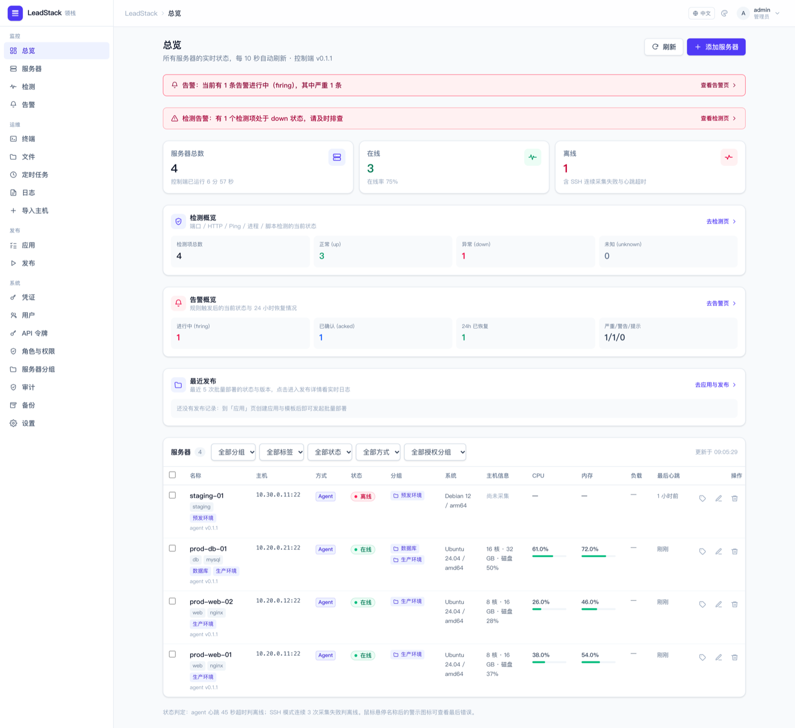
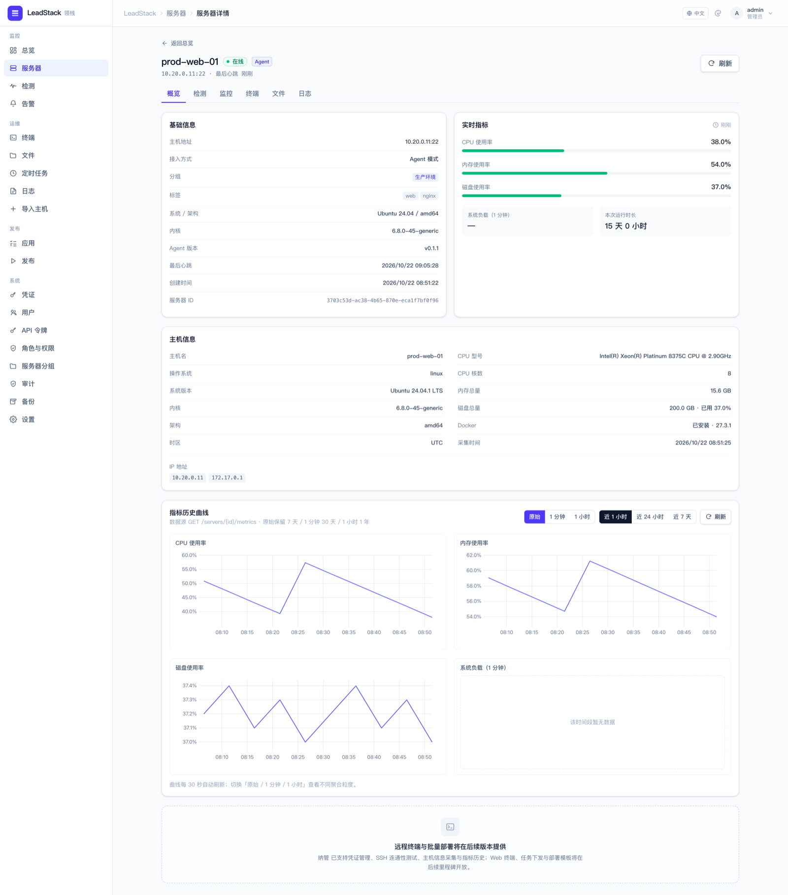
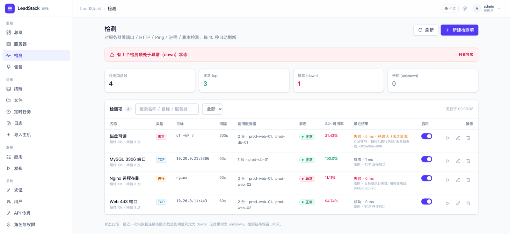
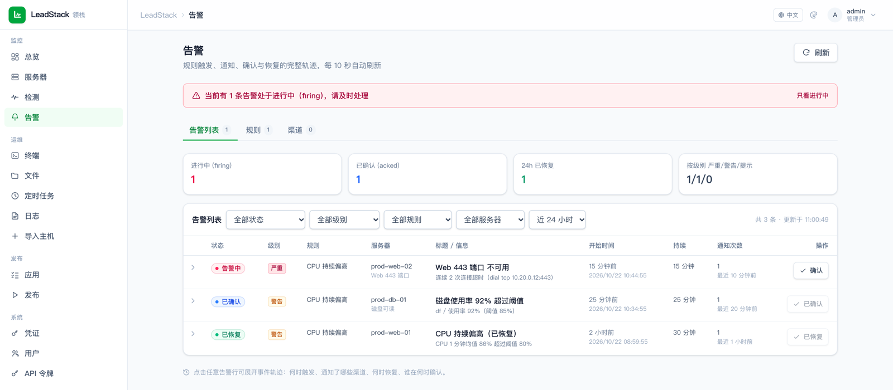
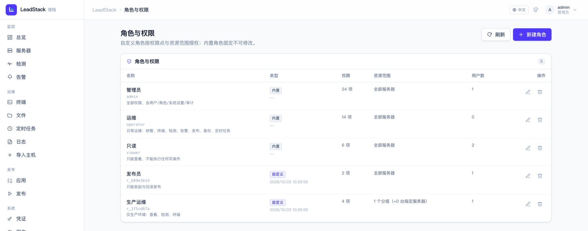
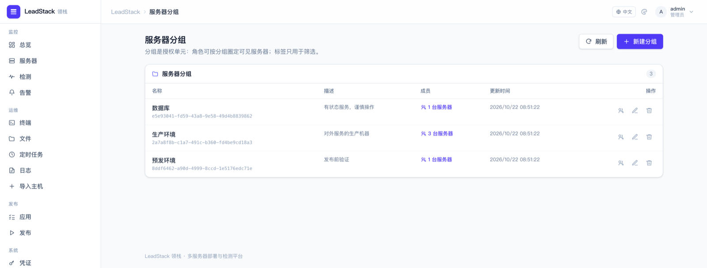
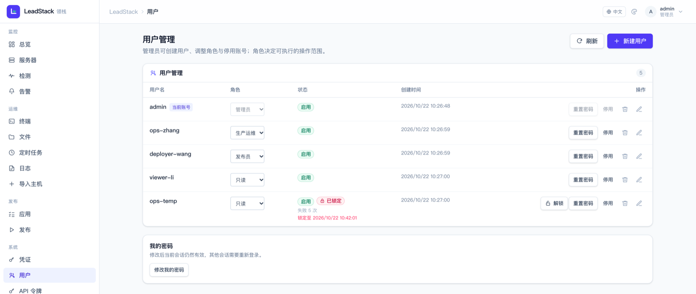
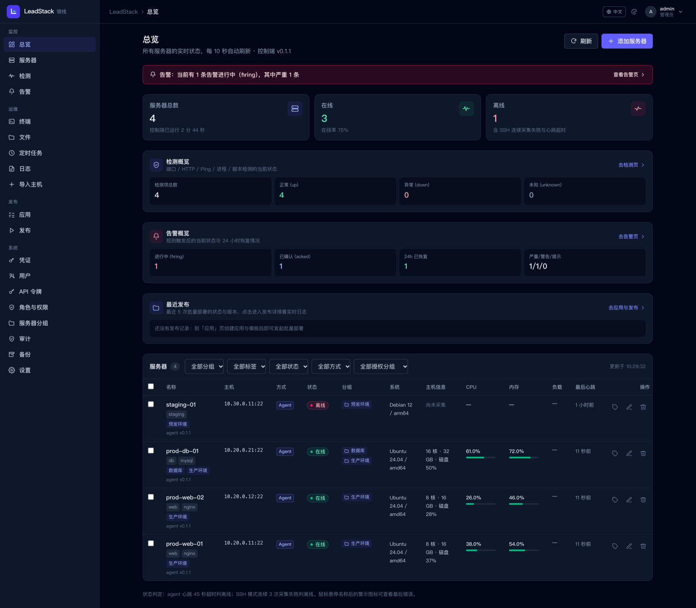

<p align="center">
  
</p>

<h1 align="center">LeadStack 领栈</h1>

> 多服务器 **部署** 与 **检测** 平台 —— 把 N 台服务器的「上线 + 值守」收进一个界面。

Go 单二进制 + 内嵌 Web 控制台 + 轻量节点 agent，跨平台、开箱即用、自托管，不按节点收费。

```
接入(Agent/SSH) → 采集 → 检测 → 告警 → 部署 → 回滚 → 备份恢复
```

---

## 目录

- [界面一览](#界面一览)
- [快速开始（5 分钟）](#快速开始5-分钟)
- [详细开始流程](#详细开始流程)
- [受限网络部署](#受限网络部署不能开端口--只有-ip--目标机要独立探活)
- [生产部署：systemd](#生产部署systemd)
- [版本升级与回滚](#版本升级与回滚)
- [常见问题](#常见问题)
- [配置参考](#配置参考)
- [目录结构](#目录结构)
- [开发与验收](#开发与验收)

---

## 界面一览

> 截图取自本地演示数据，可用 `node scripts/capture-screenshots.mjs` 重新采集（详见[开发与验收](#开发与验收)）。

**总览** —— 服务器实时状态、检测与告警概览、最近发布，一屏看清全局。



**服务器详情** —— 指标曲线、主机信息、检测/终端/文件/日志入口。



**检测** —— 端口 / HTTP / Ping / 进程 / 脚本五类探测，带状态口径、24h 可用率与最近结果。



**告警** —— 触发、去重、确认、恢复的完整轨迹，支持规则与通知渠道。



**角色与权限** —— 24 个权限点自定义角色，并把角色限定到「全部 / 分组 / 单台服务器」。



**服务器分组** —— 分组是授权单元：角色按分组圈定可见范围，标签只用于筛选。



**用户** —— 角色指派、账号启用/停用、登录失败锁定与一键解锁。



**深色主题** —— 明暗主题、6 种强调色（默认**绿色**）、14/16/18px 字号与舒适/紧凑密度可切换。



---

## 快速开始（5 分钟）

**前置要求**：Go 1.27+、Node 20+ 与 pnpm 10+（仅「源码构建」需要；用一键安装脚本、预编译包或 Docker 都不需要）。

**只是想把它跑起来（生产推荐）**——一条命令搞定安装、端口、systemd 服务与初始密码：

```bash
curl -fsSL https://raw.githubusercontent.com/maliang/leadstack/master/deploy/install-control.sh \
  | sudo sh -s -- --port 9000 --admin-password '换成你自己的密码'
# 装完即可访问：http://<主机IP>:9000 （--port 不写则默认 8080）
```

脚本会在 Linux 上注册 systemd 单元（非 root 用户 `leadstack` 运行、开机自启）、在 macOS 上注册 launchd 服务，
并把端口写进 `/etc/leadstack/leadstack.env`。**重复执行同一条命令就是升级**（先停服务再换二进制），
`--uninstall` 可干净卸载（默认保留数据目录）。完整选项见[第 2 步](#第-2-步安装控制端四选一)。

也可以从源码构建：

```bash
# 1. 构建（产出两个二进制，前端已内嵌进控制端）
make build

# 2. 启动控制端（首次启动会打印随机管理员密码，请记下）
./bin/leadstack

# 3. 浏览器打开控制台并登录
open http://127.0.0.1:8080
```

登录后按界面引导（或「服务器 → 接入服务器」）**接入第一台机器**，二选一：

```bash
# 方式 A：Agent 常驻（秒级指标）——把控制台生成的一行命令贴到目标机器执行
curl -fsSL http://<控制端地址>:8080/install.sh | sh -s -- \
  --server http://<控制端地址>:8080 --token <接入令牌>

# 方式 B：SSH 免安装——在控制台「接入服务器 → SSH 免安装」里填凭证即可，目标机什么都不装
```

**60 秒内**你应该看到：服务器状态变 `online`、CPU/内存/磁盘/负载出现数据、主机信息卡填充。

> 想先确认一切正常？跑一次端到端验收（不需要真实服务器，自带测试用 SSH 端点）：
> ```bash
> make build && make devssh && bash scripts/verify_bootstrap.sh
> ```

---

## 详细开始流程

### 第 1 步：准备环境

| 项 | 要求 |
|---|---|
| 控制端主机 | 一台**常驻**的 Linux / macOS / Windows 机器（1 核 1G 起）。**必须常驻**——它一停，检测与告警就停 |
| Go | 1.27+（只在源码构建时需要） |
| Node / pnpm | Node 20+ / pnpm 10+（只在源码构建时需要） |
| 目标机 | Linux 为主（amd64/arm64），macOS / Windows 可用但为 Beta；需要 SSH 可达或能装 agent |
| 网络 | 目标机需能访问控制端端口（Agent 模式为出站连接；SSH 模式为控制端主动连目标机 22 端口或自定义端口） |

> ⚠️ **不要把控制端跑在会合盖休眠的笔记本上**，否则你会在"为什么没收到告警"上浪费一个晚上。

### 第 2 步：安装控制端（四选一）

**A. 一键安装脚本（生产推荐）**

```bash
# 最简：默认 8080，只监听 127.0.0.1
curl -fsSL https://raw.githubusercontent.com/maliang/leadstack/master/deploy/install-control.sh \
  | sudo sh -s -- --port 8080

# 对外提供服务：监听所有网卡（建议前面再加一个 TLS 反代）
curl -fsSL https://raw.githubusercontent.com/maliang/leadstack/master/deploy/install-control.sh \
  | sudo sh -s -- --bind 0.0.0.0 --port 8080 --public-url https://leadstack.example.com

# 先看它要做什么，不动系统
curl -fsSL https://raw.githubusercontent.com/maliang/leadstack/master/deploy/install-control.sh \
  | sh -s -- --dry-run --port 8080

# 离线机器：把二进制拷过去直接装
sudo sh install-control.sh --from-file ./leadstack --port 8080
```

它做的事：下载对应平台的发布包 → 校验 `checksums.txt` 里的 sha256（不匹配就中止，不覆盖已有二进制）→
安装到 `/usr/local/bin/leadstack` → 生成 `0600` 的环境文件 `/etc/leadstack/leadstack.env` →
注册并启动服务（Linux systemd / macOS launchd）→ 打印访问地址与初始密码。

| 参数 | 说明 |
|---|---|
| `--port N` | 监听端口（默认 8080）。**这就是「一键安装时指定端口」的入口** |
| `--bind ADDR` | 监听地址（默认 `127.0.0.1` 仅本机；对外用 `0.0.0.0`） |
| `--listen ADDR:PORT` | 直接给完整监听地址，优先级高于 `--bind`/`--port` |
| `--admin-password P` | 指定初始管理员密码（留空则随机生成并只打印一次） |
| `--public-url URL` | 目标机回连地址，**反代/公网访问时必填**（否则生成的安装命令是内网地址） |
| `--trusted-proxies CIDR` | 可信反代列表，逗号分隔；配了才会采信 `X-Forwarded-For` 记录真实 IP |
| `--version V` | 安装指定版本（默认 `latest`，自动解析最新 release） |
| `--data-dir DIR` | 数据目录（Linux 默认 `/var/lib/leadstack/data`） |
| `--no-service` | 只装二进制与环境文件，不注册服务 |
| `--uninstall [--purge]` | 卸载（默认保留数据目录；`--purge` 连数据一起删） |

安装之后改端口有两种方式：重跑脚本带新 `--port`（服务会自动重启），或编辑
`/etc/leadstack/leadstack.env` 里的 `LEADSTACK_LISTEN` 后 `systemctl restart leadstack`。

验收脚本：`make verify-install`（或 `bash scripts/verify_install_control.sh`，39 项）——覆盖端口参数校验、
按端口真实监听、篡改包必须中止、幂等重装、卸载保留数据、环境文件引号编码，以及 Linux systemd 单元渲染（有 docker 时）。

**B. 源码构建（开发或自建）**

```bash
git clone <repo> && cd LeadStack-领栈
make build          # 产出 bin/leadstack 与 bin/leadstack-agent
make devssh         # 可选：DEV-ONLY 测试 SSH 服务，用于本地验收，不要用于生产
```

其他常用目标：`make run`（构建并启动）、`make test`（跑测试）、`make help`（全部目标）。

**C. 预编译二进制（发布包）**

从 release 页面下载对应平台压缩包（5 平台：linux/darwin × amd64/arm64、windows/amd64），解压后直接运行：

```bash
./leadstack --version      # 确认版本
./leadstack                # 启动
```

也可以用 goreleaser 自己出包：`make release-snapshot`（产物在 `dist/`）。

**D. Docker**

```bash
# 只绑本机 8080；要对外访问把 ports 改成 "8080:8080" 并自行加 TLS 反代
docker compose -f deploy/docker-compose.yml up -d --build
docker logs leadstack | grep 初始密码     # 首次启动打印的管理员密码（仅一次）
```

`/data` 是持久化卷（数据库 + 制品 + 备份 + `master.key`），**务必保留**。

#### 二进制放在哪里都行（但数据目录跟「当前工作目录」走）

README 里的 `./bin/leadstack` 只是「`make build` 产出的、位于仓库 `bin/` 下的二进制」的写法，**不是必须的路径**。
它是单文件、无外部依赖的可执行程序（前端与安装脚本都已内嵌），可以放到任意目录或加入 `PATH`：

```bash
sudo cp bin/leadstack /usr/local/bin/leadstack     # 或用 ~/bin
leadstack --version                                # 之后在任何目录都能直接敲
```

但要注意一个坑：**默认数据目录 `./data` 是相对「你运行命令时所在的目录」**，不是相对二进制所在位置。

```bash
# 在 /home/me 下运行 → 数据落在 /home/me/data（可能不是你想要的）
leadstack

# 推荐：显式指定数据目录（服务化部署必做）
leadstack --data-dir /var/lib/leadstack

# 或固定工作目录
cd /var/lib/leadstack && leadstack
```

systemd / launchd / Docker 部署时请显式设置工作目录与 `--data-dir`（或 `LEADSTACK_DATA_DIR`），
否则升级或重启后可能「像是数据丢了」——其实是换了个目录又初始化了一份。

### 第 3 步：首次启动与初始化

```bash
./bin/leadstack
```

首次启动会打印一段**醒目横幅**（仅这一次，之后不再出现）：

```
============================================================
  LeadStack 控制端首次启动，已创建初始管理员
------------------------------------------------------------
  用户名：admin
  初始密码：<随机生成的密码>
  上述密码仅在本次创建时打印一次，请立即登录并妥善保存。
============================================================
```

紧接着是三条关键日志，都值得看一眼：

```
主密钥已就绪 source=<env|file> path=…/master.key        ← 凭证加密用，务必备份
监听地址已确定 listen=127.0.0.1:8080 source=<settings|env|default>
HTTP 监听已就绪 active_listen=127.0.0.1:8080 web=http://127.0.0.1:8080
```

默认数据目录 `./data`：

```
data/
├── leadstack.db      # 数据库（WAL 模式，单文件）
├── master.key        # 凭证加密主密钥（0600）—— 丢了所有 SSH 凭证作废
├── known_hosts       # SSH 主机密钥记录
├── artifacts/        # 上传的部署制品
├── backups/          # 备份归档
└── backup.pass       # 备份加密口令（0600）—— 必须单独保管
```

常用启动参数（也可用环境变量，见[配置参考](#配置参考)）：

```bash
./bin/leadstack --listen 0.0.0.0:8080        # 让局域网可访问（生产请加 TLS 反代）
./bin/leadstack --data-dir /var/lib/leadstack
./bin/leadstack --admin-password '我的初始密码'   # 不想用随机密码时
./bin/leadstack --terminal-enabled            # 启用浏览器终端（默认关闭）
```

### 第 4 步：登录控制台

打开 `http://127.0.0.1:8080`，用 `admin` + 日志里的初始密码登录。

**首次进入**会自动进入引导向导（欢迎 → 添加第一台服务器 → 完成），也可以跳过直接进控制台。
登录后建议立刻到「用户管理」改掉初始密码。

界面导航分四组：
- **监控**：总览 / 服务器 / 检测 / 告警
- **运维**：终端 / 文件 / 定时任务 / 日志 / 批量导入
- **发布**：应用 / 发布记录
- **系统**：凭证 / 用户 / API Token / 审计 / 备份 / 设置
右上角菜单里的「外观设置」可切换 **主题（浅色/深色/跟随系统）· 主题色 · 字号 · 密度 · 语言（中文/English）**。

### 第 5 步：接入服务器（三选一）

**A. Agent 常驻（推荐，秒级指标 + 远程执行 + 终端）**

1. 控制台「服务器 → 接入服务器 → Agent」→ 生成**接入令牌**；
2. 复制生成的一行命令，在目标机器执行（需要目标机可访问控制端）；
3. 3 秒内该机器变为 `online`。

```bash
curl -fsSL http://<控制端>:8080/install.sh | sh -s -- \
  --server http://<控制端>:8080 --token <令牌>
```
安装脚本会安装到 `/usr/local/bin`、注册 systemd（Linux）或 launchd（macOS）服务。手动安装也可：

```bash
./leadstack-agent --server http://<控制端>:8080 --token <令牌>
```

**B. SSH 免安装（目标机不装任何东西）**

1. 「凭证」页新建凭证（密码或私钥，AES-256-GCM 加密存储，界面不回显密钥）；
2. 「服务器 → 接入服务器 → SSH 免安装」→ 选凭证、填主机与端口（默认取设置里的 22）、分组与标签；
3. 保存后点「测试连通性」→ 应返回延迟、SSH banner 与主机密钥指纹；
4. 点「刷新主机信息」→ 采集 OS/内核/CPU/内存/磁盘/时区/Docker/IP。

**C. 批量导入（几十台机器用这个）**

「服务器 → 批量导入」粘贴文本，支持 `host[:port]`、`#` 注释、IPv6（`[::1]:22`）、自动去重、逐行报错：

```
10.0.0.11
10.0.0.12:2222
# 数据库组
db-01.internal
```

选好凭证、分组、标签后导入，结果会逐条列出成功与失败原因。

> **端口**：每台机器可单独设 SSH 端口；全局默认端口在「设置 → 网络与端口」里改。建完也可以随时在服务器编辑里改地址与端口（改完会自动重测连通性并重新校验主机密钥）。

### 第 6 步：建立检测

「检测 → 新建检测项」，支持五类：

| 类型 | 填什么 | 执行位置 |
|---|---|---|
| TCP 端口 | `host:port` | 控制端直连（外部视角） |
| HTTP 拨测 | URL + 期望状态码（可选关键字、跳过证书校验） | 控制端直连 |
| Ping | 主机名/IP | 控制端（需非特权 ICMP 权限） |
| 进程 | 进程名 + 最少数量 | 目标机（Agent 下发 / SSH） |
| 脚本 | shell 脚本 + 期望输出 | 目标机（Agent 下发 / SSH） |

设置**间隔**（最小 10s）、**超时**、**连续失败阈值**（达到即判 `down`），并选择适用服务器。
保存后点「立即执行」可逐台看结果；之后按间隔自动调度，结果保留 30 天，可在服务器详情「检测」标签看时间线。

> 五类里最容易踩坑的是 **Ping**：非特权 ICMP 在部分环境不可用（如 macOS 非 root），此时会返回明确报错而不是假成功。生产建议优先用 TCP/HTTP 拨测。

### 第 7 步：配置告警通知

1. 「告警 → 渠道 → 新建渠道」：支持 **Webhook / 钉钉 / 企业微信 / 飞书 / Slack / Telegram / 邮件**；
2. 填完点「**测试发送**」——成功会显示服务商返回；失败会显示分类原因（DNS 失败 / 连接失败 / 凭据被拒 / 服务商拒绝）并附带探测结果；
3. 「告警 → 规则 → 新建规则」：选触发来源
   - **检测项**：某个检测项某台机器变 `down`
   - **服务器**：某台机器离线
   - **指标**：如 `cpu.pct > 90`、`disk.used_pct >= 85`
4. 设 **持续时长**（异常要连续存在 N 秒才告警，滤掉抖动）、**去重窗口**（未恢复期间不重复打扰）、**严重级别**、**渠道**；
5. 维护窗口可用规则上的「临时静默」；`duration_s=0` 即取消静默。

语义要点：**静默只抑制"新故障"通知，恢复通知仍会送达**；同一故障未恢复期间只保留一条告警，超过去重窗口才再次提醒。

### 第 8 步：部署第一个应用

1. **应用**：「应用 → 新建应用」（名称 + slug），部署路径为 `<部署根>/<slug>`；
2. **模板**：`binary`（下载解压落位）/ `compose`（容器编排）/ `systemd`（服务单元），内置示例可一键填充；
   支持 `{{ROOT}}`、`{{VERSION}}`、`{{RELEASE_DIR}}`、`{{ARTIFACT_URL}}`、`{{ARTIFACT_SHA256}}` 等占位符，并可「渲染预览」看替换结果；
3. **制品**：填 URL（**必须提供 sha256**）或上传文件（服务端自动算校验和）；
4. **发布**：选应用 → 模板 → 版本 → 制品 → 目标服务器（可按分组/标签全选）→ 确认；
5. 详情页可看**逐台状态 + 实时增量日志**；失败可「重试失败项」，也可「回滚」。

**接管已有项目**（目录型 / systemd 型）：
- 应用「部署方式 = 接管已有目录」→ 填目标目录（或从服务器详情「接管已有应用」自动探测并回填）；
- 每次发布：备份到 `<目标目录>/.leadstack-backups/` → rsync 覆盖（`keep_paths` 里的数据/配置目录保留）→ 执行重启命令；
- 首版可用 `init_script` 做一次性初始化（每台服务器只执行一次），`env_json` 会写成 `.leadstack.env`（0600）；
- 配了 `healthcheck_path` + `healthcheck_port` 时，部署后控制端会真实发 HTTP 检查，失败自动回滚到上一版。

**发布前可预览**：向导里点「预览」，会按服务器列出将执行的步骤、回滚步骤与风险提示（含机密内容的步骤只显示「已隐藏」），确认后再发布。
同时内置 6 个部署预设（git pull / 静态接管 / 宝塔站点 / systemd / compose / LaravelS），一键建模板并预填参数。

**脚本模式**（适合「服务器上已有项目、更新就是 git pull + 重启」）：
- 应用「部署方式 = 自定义脚本」，工作目录填项目根；发布时执行 **binary 模板的内容**（需要制品的机会都没有）；
- 模板里写完整更新流程，例如 `cd /www/wwwroot/tuoluojiang && git pull --ff-only && bash start.sh restart`；
- 可选「回滚脚本」（`git reset --hard HEAD@{1} && bash start.sh restart`），发布失败或健康检查不通过时自动执行。

保证可靠性的三个设计：
- 每次发布写独立的 `releases/<id>` 目录，**成功后才原子切换 `current` 符号链接** —— 失败绝不破坏线上；
- **回滚是秒级的**（`current` 指回上一版本，不重新下载）；
- sha256 校验不通过就失败，且 `current` 保持不变。

> 若使用「上传型制品」，需配置**控制台对外地址**（设置 → 网络与端口），否则目标机无法回连下载。

#### 已有宝塔面板？用面板 API 直接部署（不需要 SSH）

应用可在「部署方式」里选 **宝塔面板**：控制端用面板 API 建站（或复用已有站点）→ 上传 zip → 解压到站点目录，
可选部署后健康检查；失败会用部署前的站点备份自动回滚。

1. **面板准备**：宝塔面板 →「设置 → API 接口」→ 开启 API，复制密钥，并把**控制端出口 IP** 加入白名单；
2. **加凭据**：「凭证 → 新建凭证 → 宝塔面板」，填面板地址（如 `https://1.2.3.4:8888`）、API 密钥；
   面板多为自签证书，内网可用「跳过证书校验」；建好后点**测试连接**确认；
3. **绑到服务器**：服务器 →「编辑」或新建向导里选「宝塔面板凭据」（和 SSH 凭据互不影响，可以都绑）；
4. **应用选通道**：「新建应用 → 部署方式 = 宝塔面板」，填站点名（默认 slug）、端口、站点类型（static/php）、
   健康检查路径（可选）；
5. **发布**：本次发布请选 **zip 制品**（≤16MB）。已有站点只会被复用，**不会改写**面板里的目录/端口配置。

> 版本范围：v1 覆盖 static/php 站点；node 项目、SSL、反向代理仍需在面板里手工配置。
> 面板端证书、上传大小限制等细节见 [架构文档 §57](docs/ARCHITECTURE.md)。

#### 只在一台机器上？一键接入本机

服务器页「接入本机」会创建一台 `mode=agent` 的本机服务器，并给出一条可直接粘贴执行的命令：

```bash
curl -fsSL 'http://127.0.0.1:8080/install.sh' | sh -s -- --server 'http://127.0.0.1:8080' --token '…'
```

执行后 agent 常驻（systemd/launchd），状态与指标是**推送**的（心跳 20s、指标 15s、45s 无心跳判离线），
比 SSH 轮询（默认 30s 采集、连续 3 次失败才判离线）更接近实时。之后的部署与远程机器完全一致。

### 第 9 步：配置备份（强烈建议立刻做）

「备份 → 立即备份」或让它按间隔自动备份。归档是**加密的**（`LSBAK1`），包含数据库、`master.key`、`known_hosts`，可选含制品。

```bash
# 命令行备份（服务运行中也能做，SQLite 一致性快照）
leadstack backup --data-dir ./data --out /tmp/leadstack.lsbak

# 校验
leadstack backup verify --file /tmp/leadstack.lsbak

# 离线恢复（必须先停服务）
leadstack restore --file /tmp/leadstack.lsbak --data-dir ./data
```

> ⚠️ **`backup.pass` 是解密备份的唯一钥匙，必须与备份文件分开保管**（另一台机器/密码管理器/离线介质）。
> 它不在归档里；丢了它，备份永久无法解密。恢复前数据会自动移到 `<data_dir>.pre-restore-<时间>/` 保留。

### 第 10 步：多人协作与安全

| 能力 | 说明 |
|---|---|
| **用户与角色** | 内置 `admin`（全部）/`operator`（日常运维）/`viewer`（只读）；另有 **自定义角色**：24 个权限点自由勾选 |
| **服务器分组与资源级授权** | 分组是一等公民（可建/改/删/管成员）；角色可限定「全部 / 指定分组 / 指定服务器」，受限用户只能看到并操作范围内的机器与检测、告警、发布、定时任务 |
| **登录保护** | 连续失败 `N` 次锁定账号（默认 5 次 / 15 分钟），同 IP 有频率上限；管理员可一键解锁；锁定与解锁均进审计 |
| **API Token** | 「系统 → API Token」创建 `lsk_` 令牌供 CI/脚本调用；**明文只显示一次**，可撤销、可设过期 |
| **审计日志** | 所有写操作自动记录（谁、何时、哪个 IP、改了什么），敏感字段脱敏；保留 180 天 |
| **凭证安全** | SSH 密码/私钥 AES-256-GCM 加密、接口不回显；主机密钥变更即拒绝连接 |
| **终端开关** | 浏览器终端默认关闭，需 `LEADSTACK_TERMINAL_ENABLED=true` 或 `--terminal-enabled` 开启 |

### 第 11 步：日常运维

- **终端**：「运维 → 终端」或服务器详情 →「终端」，浏览器里直接上机（ssh 与 agent 两种接入都支持，尺寸自适应）。
- **文件**：「运维 → 文件」，浏览/上传/下载/删除（ssh 走 SFTP，agent 走受控通道，单文件默认 ≤ 8 MiB）。
- **日志**：「运维 → 日志」，填路径 + 行数 + 关键字过滤。
- **进程/端口**：服务器详情 →「监控」标签，跨平台采集（Linux `ps`/`ss`，macOS `ps -ww -axo`/`lsof`，含 `ss→netstat→lsof` 回退）。
- **定时任务**：「运维 → 定时任务」，5 字段 cron（带人话预览），可对一组服务器定时执行命令并保留运行历史。
- **批量导入**：「运维 → 批量导入」（也可从服务器列表进入）。

### 端口与网络

三处端口都能改，**且保证不会把自己锁在门外**：

| 改什么 | 在哪改 | 生效 |
|---|---|---|
| 控制台监听端口 | 设置 → 网络与端口 | **重启后生效**（界面会显示"当前生效 → 配置值"与重启命令） |
| 控制台对外地址 | 同上（目标机回连用：安装命令、上传制品下载） | 立即生效 |
| 目标机 SSH 端口 | 设置里改「默认端口」；单台在服务器编辑里改 | 立即生效 |

**万一控制台打不开**（端口被占用/被封禁/改错了）：

```bash
leadstack network --show                      # 看 设置/环境变量/默认 三者取值
leadstack network --listen 127.0.0.1:9090     # 离线改设置（下次启动生效）
leadstack --listen 127.0.0.1:9090             # 临时用指定端口启动（不改配置）
leadstack network --reset                     # 清除网络设置，回落环境变量/默认
```

启动绑定失败时会**自动回退**（命令行 → 设置 → 环境变量 → 默认 → 临时端口），并在日志和界面明确告警，不会静默退出。

---

## 受限网络部署（不能开端口 / 只有 IP / 目标机要独立探活）

三个真实场景，结论先给：**目标机永远不需要开放入向端口**，因为 agent 是出向客户端。

| 你的网络限制 | 能不能用 | 怎么做 |
|---|---|---|
| 目标机不能多开端口（只允许出向 80/443） | ✅ | 用 **agent 接入**：agent 主动连控制端 `/agent/ws`，目标机上一个端口都不用开 |
| 不想给目标机 SSH 账号，又想用已有端口 | ✅ | 让 nginx 从现有 443 反代到控制端（见下方配置），目标机照样走 agent |
| 只能 IP 访问、没法上 HTTPS | ✅ | 明文 HTTP（靠防火墙白名单兜底）或自签证书 + `--ca`，见下文 |
| 目标机必须自己探测本机端口/HTTP | ✅ | 检测项选「由 agent 执行」（`probe_via=agent`） |
| 目标机完全不能出网 | ❌ | 任何模式都不行（控制端连不进去，agent 也出不来） |

### 1. SSH 还是 agent？

| | agent 模式（推荐） | SSH 模式 |
|---|---|---|
| 目标机开端口 | **不需要** | 需要 22（或在设置里改的 SSH 端口） |
| 状态实时性 | 心跳 20s / 指标 15s，断线 45s 判定离线 | 每 30s 轮询一次，连续 3 次失败才判离线（最差 ~90s） |
| 需要凭据 | 只填接入令牌 | 需要账号密码或私钥 |
| 部署执行 | agent 执行 | 控制端 SSH 执行 |

> 端口与实时性的差异见「端口与网络」上方对比；本机接入见第 5 步的「一键接入本机」。

### 2. 用 nginx 从已有端口反代（不开新端口）

```nginx
server {
    listen 443 ssl;
    server_name leadstack.example.com;
    ssl_certificate     /etc/nginx/certs/fullchain.pem;
    ssl_certificate_key /etc/nginx/certs/privkey.pem;

    client_max_body_size 512m;   # 制品可能很大

    location / {
        proxy_pass http://127.0.0.1:8080;
        proxy_http_version 1.1;                     # ← 必须：WebSocket 需要 1.1
        proxy_set_header Upgrade $http_upgrade;      # ← 必须：agent 长连接靠它升级
        proxy_set_header Connection "upgrade";       # ← 必须
        proxy_set_header Host $host;
        proxy_set_header X-Forwarded-For $proxy_add_x_forwarded_for;
        proxy_set_header X-Forwarded-Proto $scheme;
        proxy_read_timeout 3600s;                   # ← 心跳 20s，别短于它
        proxy_buffering off;
    }
}
```

反代之后还有 **两件必做**：

1. **设置 → 网络与端口 → 对外地址** 改成 `https://leadstack.example.com`。否则安装命令和制品下载地址还会是 `127.0.0.1:8080`，目标机拿到就跑不通（改完立即生效，不用重启）。
2. **加可信代理白名单**，否则审计与登录限流看到的全是 nginx 的 IP：

```bash
LEADSTACK_TRUSTED_PROXIES="127.0.0.1/32,10.0.0.0/8"   # 或 --trusted-proxies
```

> 只有对端 IP 命中白名单时才会解析 `X-Forwarded-For`（从右往左取第一个不信任的地址），非白名单的请求头里写什么都不认。

优先用**子域名**而不是子路径：`/agent/ws`、`/api/v1`、`/install.sh` 都是绝对路径，挂到 `/leadstack/` 下需要额外 rewrite。

验证反代是否通（期望 `401`，说明已到控制端只是没带令牌；`502/504` 说明反代本身有问题）：

```bash
curl -i -H 'Connection: Upgrade' -H 'Upgrade: websocket' https://leadstack.example.com/agent/ws
```

### 3. 只有 IP、没有 HTTPS（或自签证书）

agent 只信任系统证书库，所以：

- **明文 HTTP**：`--server http://1.2.3.4:8080` 直接可用。**但要清楚代价**：这条通道能下发任意命令，等于 root。至少配好防火墙白名单（只放目标机 IP）或走 VPN。
- **自签 HTTPS**：证书必须包含目标机访问用的 **IP SAN**，否则会报
  `x509: cannot validate certificate for 1.2.3.4 because it doesn't contain any IP SANs`。然后给 agent 指定 CA：

```bash
# 生成带 IP SAN 的自签证书
openssl req -x509 -newkey rsa:2048 -nodes -days 3650 \
  -keyout key.pem -out cert.pem \
  -subj "/CN=1.2.3.4" -addext "subjectAltName=IP:1.2.3.4"

# 目标机：把 cert.pem 拷过去，安装 agent 时带上
sh install.sh --server https://1.2.3.4:8443 --token <token> --ca /etc/leadstack/ca.pem
```

`--ca` 是**追加**信任（保留系统 CA），仍会校验证书链与主机名；只有实在没法装 CA 时才用 `--insecure`（跳过校验，不推荐）。

- **连证书都不想折腾**：在目标机上开一条反向隧道，agent 连本地端口即可（仍然是出向，不需要目标机开端口）：

```bash
ssh -N -L 127.0.0.1:9090:127.0.0.1:8080 user@控制端
./leadstack-agent --server http://127.0.0.1:9090 --token <token>
```

### 4. 目标机自己探活（`probe_via=agent`）

默认 `tcp` / `http` / `ping` 检测是**控制端直连**目标——目标机在内网 NAT 后面时这就探不到（控制端连不进去）。把检测项的「探测通道」改成 **由 agent 执行**，探测就由目标机自己发起：

- 支持 `tcp` / `http` / `ping`；`process` / `script` 本来就在目标机执行，不接受这个参数（传了返回 400）。
- 服务器必须是 **agent 接入**；SSH 接入的服务器会返回明确错误，**不会静默回落到控制端直连**。
- 请求路径：控制端把它包成一次 `job.exec`（`kind=probe`）下发给 agent，agent 在本地执行后回传结果（延迟、状态码、消息）。

---

## 生产部署：systemd

**为什么要 systemd**：控制端必须常驻（检测、告警、采集都靠它）。用 `nohup` 或终端跑，一旦退出监控就静默失效。

完整步骤（仓库里有现成单元模板 `deploy/leadstack.service`，已含加固项与 `StateDirectory`）：

```bash
# 1) 专用系统用户（不给登录 shell，最小权限）
sudo useradd --system --home /var/lib/leadstack --shell /usr/sbin/nologin leadstack

# 2) 目录：数据 + 配置
sudo install -d -o leadstack -g leadstack /var/lib/leadstack /etc/leadstack

# 3) 二进制（放哪都行，但推荐进 PATH）
sudo install -m 0755 bin/leadstack /usr/local/bin/leadstack
sudo install -m 0755 bin/leadstack-agent /usr/local/bin/leadstack-agent

# 4) 环境文件（监听地址、数据目录等；0640 防泄露）
sudo install -m 0640 deploy/leadstack.env.example /etc/leadstack/leadstack.env
sudoedit /etc/leadstack/leadstack.env      # 至少确认 LEADSTACK_DATA_DIR=/var/lib/leadstack/data

# 5) 单元文件
sudo install -m 0644 deploy/leadstack.service /etc/systemd/system/leadstack.service

# 6) 启用并启动
sudo systemctl daemon-reload
sudo systemctl enable --now leadstack

# 7) 首次启动的初始密码在 journal 里（仅打印一次，务必立刻记下）
sudo journalctl -u leadstack -n 50 --no-pager
```

单元文件的关键设置（照抄即可，已写在模板里）：

| 项 | 值 | 作用 |
|---|---|---|
| `User` / `Group` | `leadstack` | 不用 root 跑 |
| `WorkingDirectory` | `/var/lib/leadstack` | 数据目录基准 |
| `EnvironmentFile` | `/etc/leadstack/leadstack.env` | 集中管理环境变量 |
| `Restart=always` / `RestartSec=3` | — | 崩溃自动拉起 |
| `TimeoutStopSec=20` | — | 给 SQLite 刷盘留时间 |
| `StateDirectory=leadstack` | — | 自动创建并设置权限 |
| `ProtectSystem=strict` + `ReadWritePaths` | — | 只允许写数据目录 |

**不用 root 也能用的端口**：非 root 进程只能绑 ≥1024 的端口。想用 80/443 请在前面加反向代理，或给二进制加 `CAP_NET_BIND_SERVICE`（模板里默认收紧了 capability，按需放开）。

**对外访问**：默认只监听 `127.0.0.1:8080`。要让 agent/浏览器从别的机器访问，把 `LEADSTACK_LISTEN` 改成 `0.0.0.0:8080`（或在控制台「设置 → 网络与端口」改），**并在前面加 TLS 反向代理**：

```nginx
location / {
    proxy_pass http://127.0.0.1:8080;
    proxy_http_version 1.1;
    proxy_set_header Upgrade $http_upgrade;      # 终端/日志需要 WebSocket
    proxy_set_header Connection "upgrade";
    proxy_set_header Host $host;
    proxy_read_timeout 3600s;                     # 长连接别被掐
}
```

日常运维命令：

```bash
sudo systemctl status leadstack          # 状态
sudo journalctl -u leadstack -f          # 实时日志
sudo systemctl restart leadstack         # 重启（改端口/升级后）
leadstack network --show                 # 查看当前生效的网络配置
```

> macOS 用 launchd、Windows 用服务管理器；`deploy/install.sh` 已覆盖 agent 侧的 systemd/launchd 注册。控制端在 macOS 可先用 `launchctl` 或 `brew services` 托管，原理相同。

---

## 版本升级与回滚

发布物在 GitHub Releases（每个 tag 产出 5 平台 × 2 二进制 + `checksums.txt`）。升级地址、各平台实测结果与已知限制见 [升级链路验证报告](docs/UPGRADE-VERIFY.md)。

**控制台一键升级**（推荐）：新版本会出现在控制台（用户菜单「版本与升级」与设置页），点一下就完成
**检查 → 自动备份 → 下载校验 → A/B 替换 → 重启**；若新版本起不来，**独立 watchdog 会自动回退**
（含把数据恢复到升级前的备份）。你也可以关掉它（`LEADSTACK_UPGRADE_ENABLED=false`）只用下面的手动方式。

> 自动升级只在**你点击时**发生，不会后台偷跑。Windows 不支持进程内自升级（会明确拒绝），请用手动方式。

**升级三步**：

```bash
# 1) 先备份（服务运行中也能做）
leadstack backup --data-dir /var/lib/leadstack/data --out /root/pre-upgrade.lsbak
leadstack backup verify --file /root/pre-upgrade.lsbak

# 2) 换二进制（保留旧版用于回滚）
sudo systemctl stop leadstack
sudo install -m 0755 leadstack /usr/local/bin/leadstack.new
sudo mv /usr/local/bin/leadstack /usr/local/bin/leadstack.prev
sudo mv /usr/local/bin/leadstack.new /usr/local/bin/leadstack
sudo systemctl start leadstack

# 3) 验证（版本 + 迁移日志 + 抽查一台机器）
curl -s http://127.0.0.1:8080/healthz | jq .
sudo journalctl -u leadstack -n 60 --no-pager | grep 数据库迁移
```

**为什么必须先备份**：数据库迁移是**前向 only**，没有 down 迁移。升级后想退回旧版本，可靠做法是「旧二进制 + 升级前的备份」——只换回旧二进制去读新库结构，属于不受支持的做法。

**回滚**：

```bash
sudo systemctl stop leadstack
sudo mv /usr/local/bin/leadstack.prev /usr/local/bin/leadstack
leadstack restore --file /root/pre-upgrade.lsbak --data-dir /var/lib/leadstack/data   # 数据也退回去
sudo systemctl start leadstack
```

**Docker**：compose 里固定版本号（不要 `latest`），升级 = 改 tag → `docker compose pull && up -d`；数据在 `/data` 卷里不受影响，但升级前请把 `/data/backups` 里的归档和 `backup.pass` 拷出来。

**agent**：控制台「服务器 → 批量操作 → Agent 升级」按版本批量升级；agent 用 A/B 重命名替换，校验 sha256 失败会保留旧版本不断连。

> 完整 runbook（含发布流程、兼容性承诺、跨版本升级、常见坑）见 **[docs/UPGRADE.md](docs/UPGRADE.md)**。

---

## 常见问题

**Q：启动后打不开 `http://127.0.0.1:8080`？**
看启动日志里的 `active_listen`——端口可能被占用而**自动回退**到了别的地址。按日志提示的地址访问，或用上面的 `leadstack network` 修正。

**Q：agent 显示离线？**
1. 目标机能否访问控制端端口（`curl http://<控制端>:8080/healthz`）；
2. agent 日志（systemd：`journalctl -u leadstack-agent -f`；手动运行看终端）；
3. 接入令牌是否已过期/被用过；
4. 控制端是否重启过（agent 会自动重连，最多退避 60s）。

**Q：SSH 模式连不上？**
「测试连通性」会给出具体原因：DNS 失败 / 连接被拒 / 认证失败 / 主机密钥不匹配。
主机密钥不匹配通常是因为目标机重装过——到服务器编辑里改一下地址或重新确认指纹（该机旧记录会被清除）。

**Q：收不到告警？**
按顺序查：规则是否启用 → 渠道「测试发送」是否成功 → 规则的目标（服务器/检测项）是否正确 → 是否处在静默期 → 严重级别是否被过滤。审计日志里能看到规则的增改记录。

**Q：发布失败了，线上没事吧？**
没事。失败时 `current` 仍指向上一个成功版本。看发布详情的「失败步骤」与日志，修好后重试或回滚即可。

**Q：备份恢复后凭证还能用吗？**
能——归档包含 `master.key`，它与数据库是配套的。但如果用错口令或把别的机器的数据库配这个 `master.key`，凭证会解不开。

**Q：忘了备份口令怎么办？**
无解，这是加密设计的必然结果。所以务必把 `backup.pass` 与备份分开保管。

**Q：能不能暴露到公网？**
可以，但**请在前面加 TLS 反向代理**（Caddy/Nginx），并改初始密码、按需创建 `operator`/`viewer` 账号。控制台默认只监听 `127.0.0.1` 就是这个原因。

---

## 配置参考

### 环境变量

优先级：**控制台设置 > 环境变量 > 内置默认**（端口类；其余项只读环境变量）。

| 环境变量 | 默认值 | 说明 |
|---|---|---|
| `LEADSTACK_LISTEN` | `127.0.0.1:8080` | 监听地址；也可在设置页改（控制台设置优先） |
| `LEADSTACK_DATA_DIR` | `./data` | 数据目录（数据库、主密钥、制品、备份） |
| `LEADSTACK_ADMIN_PASSWORD` | 随机生成 | 初始管理员密码，仅首次初始化生效 |
| `LEADSTACK_MASTER_KEY` | 无（用 `master.key`） | 64 位 hex 凭证加密主密钥 |
| `LEADSTACK_PUBLIC_URL` | 无 | 目标机回连地址；上传型制品必填。设置页可改 |
| `LEADSTACK_SSH_INTERVAL` | `30s` | SSH 模式采集间隔（1s–24h） |
| `LEADSTACK_CHECK_CONCURRENCY` | `8` | 检测调度并发上限 |
| `LEADSTACK_CHECK_INTERVAL_MIN` | `10s` | 检测项最小间隔 |
| `LEADSTACK_ALERT_EVAL_INTERVAL` | `30s` | 告警规则评估周期 |
| `LEADSTACK_ALERT_RETENTION_DAYS` | `90` | 已恢复告警保留天数 |
| `LEADSTACK_AUDIT_RETENTION_DAYS` | `180` | 审计日志保留天数 |
| `LEADSTACK_DEPLOY_ROOT` | `/opt/leadstack/apps` | 部署基础目录（实际 `<root>/<slug>`） |
| `LEADSTACK_DEPLOY_CONCURRENCY` | `4` | 发布并发上限 |
| `LEADSTACK_ARTIFACT_MAX_MB` | `512` | 上传制品大小上限 |
| `LEADSTACK_BACKUP_DIR` | `<data_dir>/backups` | 备份目录 |
| `LEADSTACK_BACKUP_INTERVAL` | `24h` | 定时备份间隔 |
| `LEADSTACK_BACKUP_RETENTION` | `7` | 备份保留份数 |
| `LEADSTACK_BACKUP_INCLUDE_ARTIFACTS` | `false` | 备份是否含上传制品 |
| `LEADSTACK_BACKUP_PASSPHRASE` | 无（用 `backup.pass`） | 备份加密口令 |
| `LEADSTACK_TERMINAL_ENABLED` | `false` | Web 终端开关 |
| `LEADSTACK_CRON_TICK` | `1m` | 定时任务扫描间隔 |
| `LEADSTACK_FILE_MAX_MB` | `8` | 文件传输单文件上限 |
| `LEADSTACK_LOGIN_MAX_ATTEMPTS` | `5` | 账号连续登录失败锁定阈值（0=关闭） |
| `LEADSTACK_LOGIN_LOCK_DURATION` | `15m` | 账号锁定时长 |
| `LEADSTACK_LOGIN_IP_LIMIT` | `20` | 同一 IP 在窗口内的登录请求上限（0=关闭） |
| `LEADSTACK_LOGIN_IP_WINDOW` | `1m` | IP 限流窗口 |
| `LEADSTACK_TRUSTED_PROXIES` | 空（不信任任何代理头） | 可信反向代理 CIDR/IP 列表，逗号分隔；配置后才解析 `X-Forwarded-For` |

> ⚠️ `master.key` 丢失 → 已存凭证无法解密；`backup.pass` 丢失 → 备份永久无法解密。两者都要与数据目录一并备份，且**分开保管**。

### 命令行

```bash
leadstack                          # 启动控制端
leadstack --version                # 版本
leadstack --listen 0.0.0.0:8080    # 临时指定监听地址
leadstack network --show           # 查看网络设置（离线可用）
leadstack network --listen <addr>  # 改监听设置（离线可用）
leadstack network --reset          # 清除网络设置
leadstack backup --out <file>      # 备份
leadstack backup verify --file <f> # 校验备份
leadstack restore --file <f> --data-dir <d>   # 离线恢复（需先停服务）

leadstack-agent --server <url> --token <t>    # 节点 agent
leadstack-agent --once            # 单次上报后退出（自测）
leadstack-agent --ca <pem>        # 额外信任该 CA（控制端用自签证书时）
leadstack-agent --insecure        # 跳过 TLS 证书校验（不推荐）
```

---

## 目录结构

```
cmd/
├── leadstack/          控制端入口（子命令：network / backup / restore）
├── leadstack-agent/    节点 agent
└── leadstack-devssh/   DEV-ONLY 测试 SSH 服务（不参与发布）
internal/
├── api/ store/ auth/   服务端：HTTP/WS、SQLite、鉴权与 RBAC
├── checker/ alerting/  检测引擎、告警状态机
├── notify/             7 类通知渠道
├── deploy/ jobs/       部署编排、任务下发
├── sshx/ term/         远端执行、PTY 终端、SFTP
├── remote/ cron/       进程/端口/日志采集、cron 引擎
├── backup/ credential/ 加密备份、凭证加密
└── webui/              内嵌前端产物
pkg/protocol/           agent ↔ 控制端消息契约
web/                    React 控制台（构建后内嵌进二进制）
deploy/                 安装脚本、systemd 单元、Docker Compose
docs/                   计划书、架构契约、交付报告
scripts/                端到端验收脚本
```

---

## 开发与验收

```bash
make build          # 构建（含前端）
make test           # Go 测试
make fmt-check      # gofmt 闸门
make test-race      # 竞态检测（api + store）
make test-e2e       # 端到端验收（13 个脚本，逐段断言）
make dev            # 开发模式（另开 make web-dev 走前端热更新）
make release-snapshot  # goreleaser 快照（5 平台 10 二进制）
make docker-check   # Docker 构建 + 容器内健康检查 + 备份校验
node scripts/capture-screenshots.mjs  # 重新采集 README 截图（需先起一个带演示数据的控制端）
```

单独跑某一套验收（需要 `make build && make devssh`）：

```bash
bash scripts/verify_bootstrap.sh        # 接入、指标、离线判定
bash scripts/verify_servers.sh          # 凭证、SSH 纳管、主机信息、批量、历史
bash scripts/verify_checks.sh           # 五类检测、两条执行通道、agent 代检、调度、降级
bash scripts/verify_alerts.sh           # 渠道、firing、去重、确认、恢复、指标规则、静默
bash scripts/verify_deploy.sh           # 发布、产物落盘校验、失败保护、回滚、批量、重试、注入防护
bash scripts/verify_deploy_v2.sh        # 接管目录、健康检查、首版初始化、本机接入
bash scripts/verify_deploy_script.sh    # 脚本模式（git pull / start.sh restart 类流程）
bash scripts/verify_deploy_rollout.sh   # 灰度、回滚到指定版本、接管体检
bash scripts/verify_baota.sh            # 宝塔面板通道（mock 面板校验签名）
bash scripts/verify_backup.sh           # 加密有效性、篡改检测、离线恢复、暂存恢复、定时与保留
bash scripts/verify_ops.sh              # 审计、RBAC、Token、分页、导入、终端、文件、定时任务、端口
bash scripts/verify_authz.sh            # 权限点、自定义角色、分组与资源级授权、可信代理、登录限流
bash scripts/verify_install_control.sh  # 控制端一键安装：端口、下载校验、幂等升级、卸载、systemd 单元
```

---

## 设计原则

1. **简单优先**：一条命令启动，三步接入一台机器。
2. **批量优先**：为几十到几百台设计，而不是单机面板。
3. **部署与监控同源**：一次接入，同时具备下发应用与采集健康的能力。
4. **安全默认**：默认只监听本地、凭证加密存储、主机密钥变更即拒绝、关键操作全审计。
5. **永不锁死**：任何配置都不能让用户失去唯一的修复通道（端口绑定失败自动回退 + 离线 CLI）。

---

## 文档

- [架构与接口契约](docs/ARCHITECTURE.md) —— 改代码前必读
- [产品与技术计划](docs/PLAN.md)
- 交付报告：[基础骨架](docs/reports/bootstrap.md) · [服务器纳管](docs/reports/server-management.md) · [监控与检测](docs/reports/monitoring.md) · [告警](docs/reports/alerting.md) · [批量部署](docs/reports/deployment.md) · [备份恢复](docs/reports/backup.md) · [运维与协作](docs/reports/ops-and-collaboration.md) · [权限体系](docs/reports/roles-and-authz.md) · [宝塔面板部署](docs/reports/baota-deploy.md)
- [版本升级与回滚 runbook](docs/UPGRADE.md)（systemd / Docker / agent 升级，含回滚与兼容性承诺）
- [发布验证记录](docs/DEPLOY-VERIFY.md)（GoReleaser / Docker 实测）

## 状态

功能已完整交付，**十三套验收共 446 项断言全绿**（`make test-e2e`）。已知环境限制：
macOS 公证 / Windows 代码签名需证书；钉钉/飞书/Slack/Telegram/邮件需你的真实凭据才能验证实际投递。
