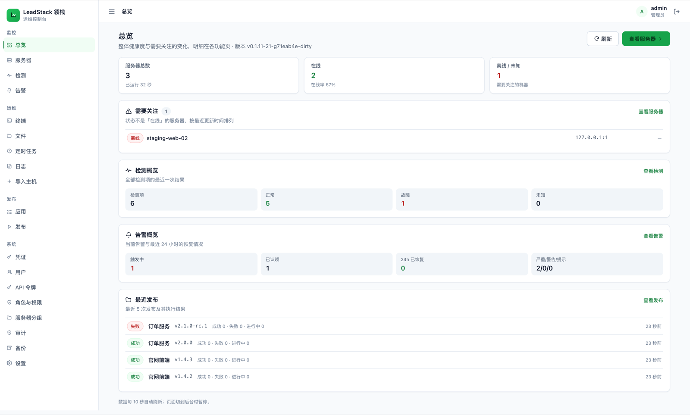
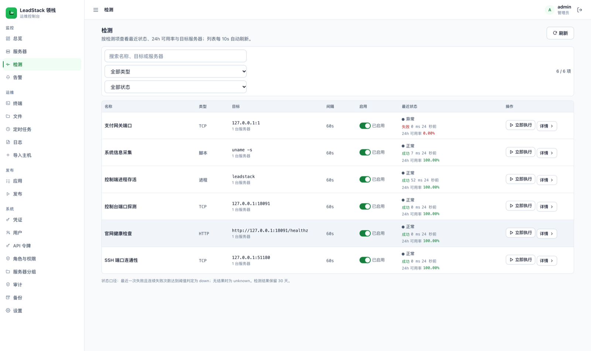
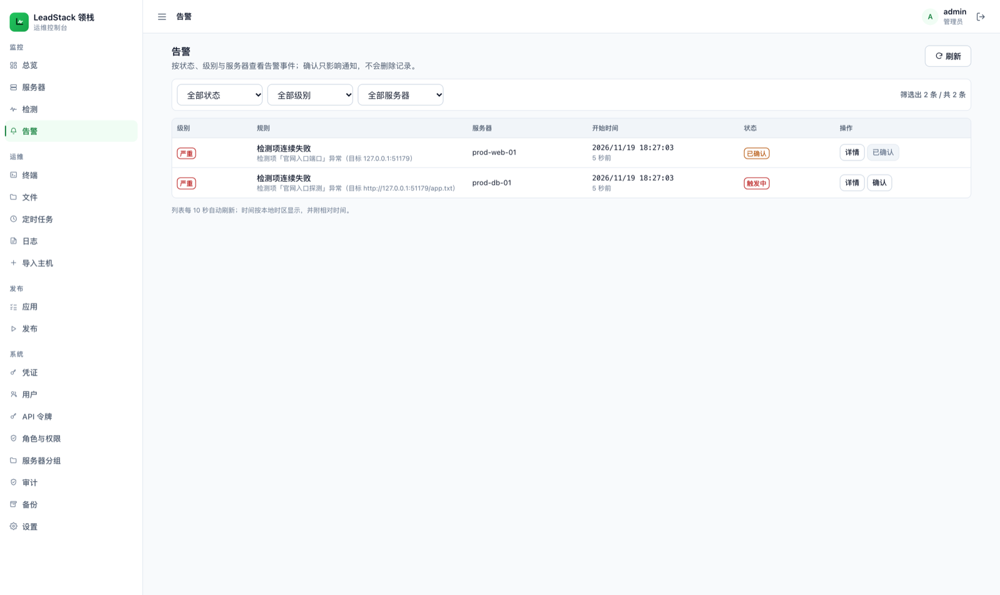
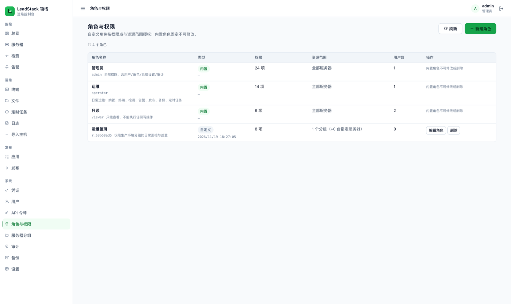
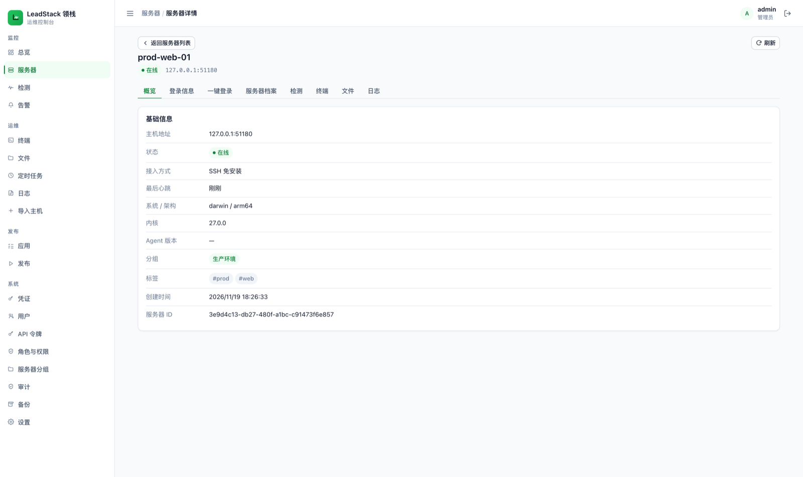
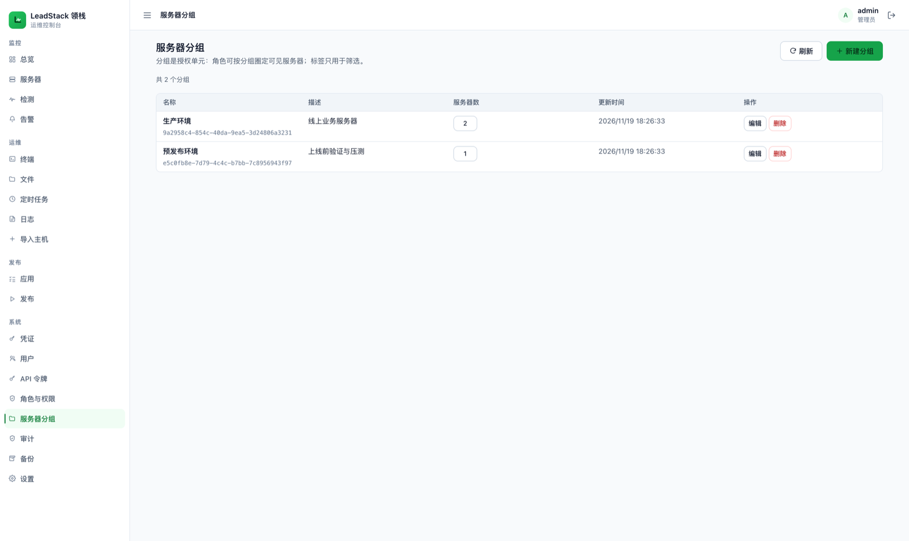
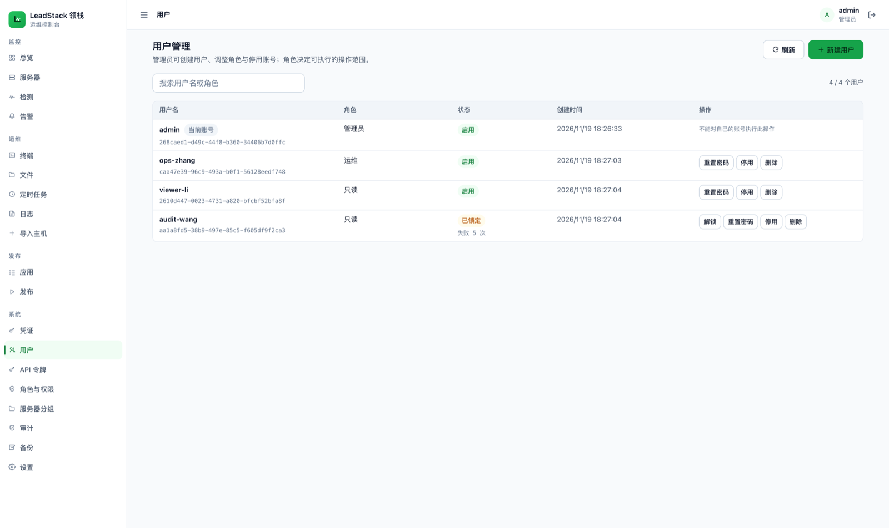
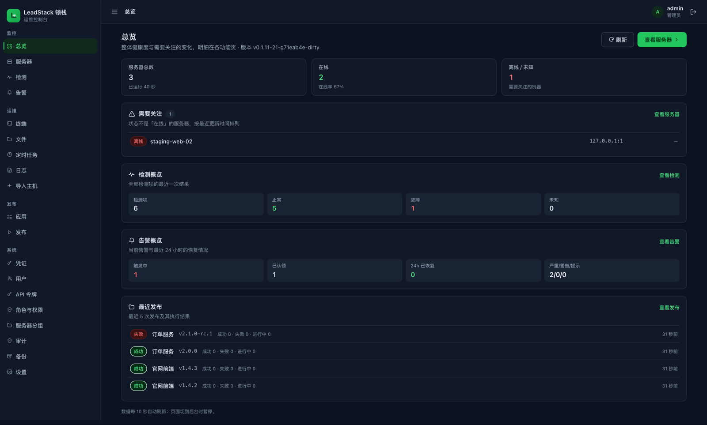

<p align="center">
  
</p>

<h1 align="center">LeadStack 领栈</h1>

> 多服务器**部署**与**安全运维**平台：把 N 台机器的「上线 + 值守」收进一个界面。

Go 单二进制 + 内嵌 Web 控制台 + 轻量 agent，跨平台、开箱即用、自托管，不按节点收费。

```
接入（Agent / SSH） → 采集 → 检测 → 告警 → 部署 → 回滚 → 备份恢复
```

---

## 目录

- [界面一览](#界面一览)
- [快速开始](#快速开始)
- [使用流程](#使用流程)
- [网络与访问](#网络与访问)
- [生产部署（systemd）](#生产部署systemd)
- [升级与回滚](#升级与回滚)
- [备份与恢复](#备份与恢复)
- [配置参考](#配置参考)
- [常见问题](#常见问题)
- [目录结构](#目录结构)
- [开发与验收](#开发与验收)
- [文档与状态](#文档与状态)

---

## 界面一览

> 截图取自本地演示数据；`node scripts/capture-screenshots.mjs` 可重新采集。

**总览** —— 服务器状态、安全检测与告警概览、最近发布。



**安全** —— TCP / HTTP / Ping / 进程 / 脚本五类探测，含 24h 可用率与最近结果；服务器详情内提供安全基线体检与基础加固。



**告警** —— 触发、去重、确认、恢复的完整轨迹；同一页面还管**通知渠道与规则**（增删改、临时静默、「测试发送」）。



**角色与权限** —— 24 个权限点自定义角色，并把范围限定到「全部 / 分组 / 单台」。



<details>
<summary>展开其余界面</summary>

**服务器列表** —— 状态、CPU / 内存 / 磁盘快照、标签与分组筛选、批量操作；绑定宝塔面板 API 密钥的机器直接显示「宝塔登录」。编辑弹窗里标签按逗号/空格/换行转成可删除标签块，分组支持下拉选择或自定义输入，分组管理已内化到服务器详情。右上角账号菜单提供「用户信息（姓名 / 电话 / 备注）」与「修改密码」，退出登录也收在菜单里。

**服务器详情** —— 概览、一键登录、访问账号、安全、日志、MySQL/MariaDB 数据库备份；SSH 登录信息放在最后一个标签页。离线服务器会显示接入指引。



**服务器分组** —— 分组是授权单元，标签只用于筛选；分组与备份都已收进服务器详情，不再占用左侧菜单。



**用户** —— 角色指派、启用/停用、登录失败锁定与一键解锁。



**深色主题** —— 深色主题预览（可在「设置 → 外观」切换浅色 / 深色 / 跟随系统）。



</details>

---

## 快速开始

**前置**：只有「源码构建」需要 Go 1.27+ 与 Node 20+ / pnpm 10+；一键安装、预编译包、Docker 都不需要。

### 方式 1：一键安装（推荐）

```bash
curl -fsSL https://raw.githubusercontent.com/maliang/leadstack/master/deploy/install-control.sh \
  | sudo sh -s -- --port 9000
# 装完访问 http://<主机IP>:9000（--port 不写默认 8080）
```

脚本会：下载并校验发布包 → 装到 `/usr/local/bin/leadstack` → 写 `0600` 环境文件 `/etc/leadstack/leadstack.env`
→ 注册服务（Linux systemd / macOS launchd）→ **顺手把本机 agent 也装好并纳管** → 打印访问地址与初始密码。

默认 `--source auto`：先走 GitHub Releases，不可达时自动回退 Gitee 镜像（`gitee.com/maliang47/leadstack`）；
国内网络也可以直接 `--source gitee` 强制使用 Gitee。脚本与系统升级都会自动判断，不需要手工改地址。

装完控制台里已有一台「本机」在线，不用再去点「接入本机」。不想被监控就加 `--no-local-agent`。
**重复执行同一条命令就是升级**（先停服务再换二进制）；`--uninstall` 卸载（默认保留数据）。

### 方式 2：源码构建

```bash
git clone <repo> && cd LeadStack-领栈
make build        # 产出 bin/leadstack 与 bin/leadstack-agent
./bin/leadstack   # 首次启动打印初始管理员密码，记下来
open http://127.0.0.1:8080
```

其他常用目标：`make run`、`make test`、`make help`。`make devssh` 是 DEV-ONLY 的测试 SSH 服务，别用于生产。

### 方式 3：Docker

```bash
docker compose -f deploy/docker-compose.yml up -d --build
docker logs leadstack | grep 初始密码     # 首次启动打印，仅一次
```

`/data` 是持久化卷（数据库、制品、备份、`master.key`），**务必保留**。只绑本机 8080；对外请改 ports 并自加 TLS 反代。

### 方式 4：GitHub / Gitee 访问异常时（镜像 / 离线安装升级）

安装脚本默认 `--source auto`：先走 GitHub Releases；GitHub API 或下载地址不可达时，自动回退到 Gitee 镜像
（`https://gitee.com/maliang47/leadstack/releases/download` 与对应 Gitee API）。也可用
`--source gitee` 直接强制 Gitee、`--source github` 强制 GitHub。

如果两个源都走不通，再二选一：

**A. 走镜像**：把下载前缀指到镜像的 release 目录，并**显式给版本号**（跳过 GitHub API 解析）：

```bash
curl -fsSL https://raw.githubusercontent.com/maliang/leadstack/master/deploy/install-control.sh \
  | sudo sh -s -- --port 9000 --version 0.1.5 \
      --base-url https://你的镜像站/maliang/leadstack/releases/download
```

镜像目录须与 GitHub Releases 同构：`v<版本>/leadstack_v<版本>_<os>_<arch>.tar.gz`（Windows 为 `.zip`）与 `v<版本>/checksums.txt`。
`install-control.sh` 还可用 `LEADSTACK_RELEASE_API=https://你的镜像站/.../releases/latest` 覆盖 latest 解析地址。

**B. 完全离线**：在能联网的机器 `make build` 出 `bin/leadstack`、`bin/leadstack-agent`，拷到目标机后跳过全部下载：

```bash
# 控制端 + 本机 agent 一起离线装（跳过下载与校验）
sudo sh deploy/install-control.sh --port 9000 \
  --from-file ./bin/leadstack --agent-from-file ./bin/leadstack-agent

# 只给已装好的控制端补/换本机 agent（用 agent 安装脚本，参数取控制台「接入服务器」那行）
sudo sh deploy/install.sh --server http://127.0.0.1:8080 --token <接入令牌> \
  --from-file ./bin/leadstack-agent
```

`--from-file` 要的是**裸二进制**（`make build` 产物），不是 `.tar.gz`。更省事的一种：把 release 的
`leadstack_v<版本>_<os>_<arch>.tar.gz`（或解压出的 `leadstack`）与安装脚本放在同一目录，脚本会自动识别并跳过下载
（优先级：`--from-file` > 同目录二进制 > 同目录归档 > 下载；本机 agent 同理找同目录的 `leadstack-agent`）。
环境变量等价写法：`LEADSTACK_INSTALL_BASE_URL`（= `--base-url`）、`LEADSTACK_CONTROL_BINARY`（= `--from-file`）、
`LEADSTACK_AGENT_BINARY`（agent 脚本的 `--from-file`）、`LEADSTACK_AGENT_BASE_URL`（本机 agent 的镜像前缀）。

**升级也走这两条路**：重复执行安装命令就是升级，但两者换文件的方式不同：

- **agent（`deploy/install.sh`）**：写 `*.new` → 停服务 → `mv` 原子替换 → 起服务，旧文件留 `*.bak` 作回滚点，新版本起不来自动换回（详见[架构契约 §44](docs/ARCHITECTURE.md)）；
- **控制端（`deploy/install-control.sh`）**：先停服务，再 `install -m 0755` 覆盖并重启；停服务失败会告警后继续。
  注意 `Text file busy` 不是这里的判定依据：GNU `install` 先 unlink 能换成功（macOS 上 `cp`/`install` 也都成功），
  但**换完没重启的话进程仍然跑旧映像**，所以「停服务失败还继续」要靠后面的重启兜住——重启也失败就必须手动 `systemctl restart`。

GitHub 不通时用镜像或 `--from-file` 指向新版二进制即可。装完/升完核对：

```bash
leadstack --version && leadstack-agent --version
```

### 装完怎么验证

登录后「服务器 → 接入服务器」，二选一：

```bash
# A. Agent 常驻（秒级指标）——把控制台生成的一行命令贴到目标机执行
curl -fsSL http://<控制端>:8080/install.sh | sh -s -- \
  --server http://<控制端>:8080 --token <接入令牌>

# B. SSH 免安装——控制台里填凭证即可，目标机什么都不装
```

**60 秒内**应看到：状态变 `online`、CPU/内存/磁盘/负载出现数据、主机信息卡填充。

> 不想接真机？跑一次端到端验收（自带测试用 SSH 端点）：
> `make build && make devssh && bash scripts/verify_bootstrap.sh`

### 安装脚本选项

| 参数 | 说明 |
|---|---|
| `--port N` | 监听端口（默认 8080） |
| `--bind ADDR` | 监听地址（默认 `127.0.0.1`；对外用 `0.0.0.0`） |
| `--listen ADDR:PORT` | 完整监听地址，优先级高于 `--bind`/`--port` |
| `--admin-password P` | 初始管理员密码；留空则随机生成 20 位并打印在汇总里 |
| `--public-url URL` | 目标机回连地址，**反代/公网必填** |
| `--trusted-proxies CIDR` | 可信反代列表；配了才采信 `X-Forwarded-For` |
| `--no-local-agent` | 不自动接入本机 |
| `--agent-from-file PATH` | 本机 agent 用本地二进制安装（离线） |
| `--version V` | 安装指定版本（默认 `latest`，需联网解析 GitHub API；镜像/离线时显式给） |
| `--base-url URL` | 发布包下载前缀（默认 `https://github.com/maliang/leadstack/releases/download`，镜像时改这里） |
| `--from-file PATH` | 用本地二进制安装控制端（离线机器），跳过下载与校验 |
| `--dry-run` | 只打印将要做什么，不动系统 |
| `--data-dir DIR` | 数据目录（Linux 默认 `/var/lib/leadstack/data`） |
| `--no-service` | 只装二进制与环境文件，不注册服务 |
| `--uninstall [--purge]` | 卸载（默认保留数据，`--purge` 连数据一起删） |

安装过程分 7 个阶段逐步打印（下载十几 MB 不空屏），每阶段有 ✓ 与耗时：

```text
[leadstack-install] (2/7) 下载控制端二进制
[leadstack-install]    ✓ 已下载 6.7 MB（版本 0.1.5）（4s）
[leadstack-install] (6/7) 健康检查
[leadstack-install]    ✓ http://127.0.0.1:8080/healthz 已返回 ok（1s）
[leadstack-install] (7/7) 接入本机（自动安装 agent）
[leadstack-install]    ✓ 本机 agent 已安装并注册 systemd 服务 leadstack-agent（已上线）（9s）
[leadstack-install]   本机接入：已自动完成（控制台「服务器」里能看到本机在线）
```

进度条只在交互终端显示（`curl … | sudo sh` 也算），`--dry-run` 打印同样的阶段序列但不改系统。

**改端口**：重跑脚本带新 `--port`（自动重启），或改 `/etc/leadstack/leadstack.env` 的 `LEADSTACK_LISTEN` 后
`systemctl restart leadstack`。

**把二进制放到别处也行**（单文件、无外部依赖），但注意**默认数据目录 `./data` 跟着当前工作目录走**：

```bash
sudo cp bin/leadstack /usr/local/bin/leadstack   # 之后任意目录可用
leadstack --data-dir /var/lib/leadstack          # 服务化部署请显式指定
```

忘了指定，重启后可能「像数据丢了」——其实是换了目录又初始化了一份。systemd / Docker 部署务必显式设置。

---

## 使用流程

### 1. 首次启动

首次启动打印一次初始管理员密码横幅（之后不再出现），并输出三条值得一看的日志：
主密钥来源（`master.key` 务必备份）、监听地址来源（设置/环境变量/默认）、实际监听地址。

默认数据目录 `./data`：

```
data/
├── leadstack.db      # 数据库（WAL，单文件）
├── master.key        # 凭证加密主密钥（0600）—— 丢了所有 SSH 凭证作废
├── known_hosts       # SSH 主机密钥记录
├── artifacts/        # 上传的部署制品
├── backups/          # 备份归档
└── backup.pass       # 备份加密口令（0600）—— 必须单独保管
```

### 2. 登录与导航

用 `admin` + 初始密码登录；首次进入会自动走引导向导，也可以跳过。登录后建议立刻改密码。导航分四组：

- **监控**：总览 / 服务器 / 安全 / 告警
- **运维**：终端 / 文件 / 定时任务 / 日志 / 批量导入
- **发布**：应用 / 发布记录
- **系统**：用户 / API Token / 审计 / 设置

外观在「设置 → 外观」里切换：主题（浅色 / 深色 / 跟随系统）、主题色（11 个预设 + 任意 #RRGGBB 自定义，深色自动调明暗）、界面密度（舒适 / 紧凑）与界面语言（简体中文 / English），
选择会持久化保存，刷新或重开后仍保持。

### 3. 接入服务器（三选一）

**A. Agent 常驻（推荐：秒级指标 + 远程执行 + 终端）**

控制台「服务器 → 接入服务器 → Agent」生成令牌，复制命令到目标机执行，3 秒内变 `online`。装脚本分 4 阶段
（检查参数 → 下载校验安装 → 确认可执行 → 注册服务）并带进度条；也可手动跑 `leadstack-agent --server … --token …`。

> 重复点「接入本机」不会再增加记录：已有本机 agent 服务器就复用，每次只换一枚新令牌（响应 `created=false`，HTTP 200；首次接入才是 `201` + `created=true`）。老库里的多条重复行见 `docs/ARCHITECTURE.md` §62.4。

**B. SSH 免安装（目标机不装任何东西）**

在「接入服务器 → SSH 免安装」里直接填该服务器的用户名、密码或私钥（AES-256-GCM 加密、界面不回显）
→ 保存后「测试连通性」应返回延迟、SSH banner 与主机密钥指纹 →「刷新主机信息」采集 OS/内核/CPU/内存/磁盘/时区/Docker/IP。

**C. 批量导入（几十台用这个）**

「服务器 → 批量导入」粘贴文本，支持 `host[:port]`、`#` 注释、IPv6（`[::1]:22`）、自动去重、逐行报错：

```
10.0.0.11
10.0.0.12:2222
# 数据库组
db-01.internal
```

选好凭证、分组、标签后导入，结果逐条列出成功与失败原因。

> 每台机器可单独设 SSH 端口，全局默认在「设置 → 网络与端口」。改地址/端口后会自动重测连通性并重新校验主机密钥。

**D. 访问账号（一台机器多条登录信息）**

服务器详情页的「访问账号」标签可以保存**多条**登录信息：名称、地址、用户名、密码、备注、自定义字段，以及每条账号各自的一键登录脚本。密码只加密存在控制端，列表默认掩码；点「显示密码 / 复制密码 / 复制整条」时才按需读取并写审计 `server.account.access`。每条账号的字段都能单独复制，自定义字段也可以逐个复制。脚本执行走 `POST /servers/{id}/accounts/{aid}/login`，返回 `url / terminal / output`，与单条一键登录同一套执行器。

**D1. 查看 SSH 登录信息（登录信息卡片）**

服务器详情页的「登录信息」卡片显示这台机器绑定的 SSH 地址、端口、用户名与密码，密码可复制，省得再去凭证库里翻。

- 需要 `server.read` 权限，且这台机器在当前角色的资源范围内；不在范围内的机器连详情都打不开（接口按「服务器不存在」返回 404，不暴露它存在）。
- 卡片默认折叠：点「展开查看」才读取一次，收起即丢弃明文；**每展开一次写一条审计 `server.access`**（谁、何时、看了哪台机器），审计里只有凭证 id 与认证类型，**没有密码**。这样「打开详情页」不会等于「导出凭据」。
- 私钥凭证的密码行显示「该服务器用私钥认证，没有可复制的密码；私钥本身不会在任何接口回显。」；没绑凭证的机器显示「服务器未绑定 SSH 凭证，无法获取登录信息」——不是界面坏了。
- 密码为什么会以明文回显、风险边界在哪：见 [架构契约 §67](docs/ARCHITECTURE.md)。一句话：读得到 = 拿到该账号的登录能力，所以生产必须上 HTTPS，怀疑泄露就轮换目标机密码并重录凭证。

命令行等价物（`<server-id>` 换成真实 id）：

```bash
TOKEN=$(curl -s -X POST http://127.0.0.1:8080/api/v1/auth/login \
  -H 'Content-Type: application/json' -d '{"username":"admin","password":"<password>"}' | jq -r .data.token)
curl -s -H "Authorization: Bearer $TOKEN" \
  http://127.0.0.1:8080/api/v1/servers/<server-id>/access | jq .data
# {"server_id":"…","name":"web-01","host":"10.0.0.11","port":22,
#  "username":"root","password":"…","auth_type":"password"}
```

**E. 一键登录（登录脚本）**

同一张「登录信息」卡片右上角是一键登录入口：没配置脚本时显示「配置一键登录」，配置后显示「一键登录」与「编辑脚本」。

- 脚本在**目标机**上执行（复用发布执行器，agent / SSH 两种接入都支持），约定输出一段 JSON，三选一：
  `{"url":"https://…"}` 用浏览器打开、`{"terminal":"ssh -p 22 root@…"}` 交给终端、`{"output":"…"}` 直接展示。
  输出不是 JSON 也不会报错——整段原文当作 `output` 显示（脚本作者最常犯的错就是 `echo` 了一段文本）。
- 需要 `server.write` 权限且服务器在范围内（执行脚本等于拿到这台机器的命令执行权，所以不给只读角色）。每次执行写审计 `server.login`，明细只有脚本长度与「是否产出 URL」，**脚本产出的链接不进审计**。
- 配置弹窗内置**宝塔 / 1Panel** 两个示例可一键填入。为什么不做「内置面板免密登录」：宝塔的「临时访问授权」只能人工在面板里生成、无公开 API；1Panel 只有 API Key 鉴权，也没有免密网页登录接口。硬做只能靠模拟登录（脆弱、要存面板管理员密码），不如让脚本自己适配。详见 [架构契约 §68](docs/ARCHITECTURE.md)。
- 脚本随服务器详情回显，因此**不要把密码写进脚本**——敏感值请放服务器自己的 SSH 凭证。

宝塔面板（v14 起）的示例脚本长这样：`bt 14` 会打印面板地址，脚本只用 `grep` 拎出完整 URL，**不打印含初始密码的整段输出**（脚本 stdout 会被记进任务日志）：

```bash
#!/usr/bin/env bash
# 宝塔面板 v14 起可用「bt 14」打印面板地址（含安全入口路径）；只提取其中的完整 URL。
# 注意：不要把含初始密码的整段输出写进脚本，脚本输出会被记录到任务日志里。
PREFIX=$(bt 14 2>/dev/null || /etc/init.d/bt 14 2>/dev/null)
# bt 14 的输出常带颜色控制码，不清洗会把转义序列吃进 URL；部分系统输出是 CRLF，\r 也会被 grep 吃进 URL 尾部。
PREFIX=$(printf '%s' "$PREFIX" | tr -d '\r' | sed -E $'s/\x1B\[[0-9;]*[A-Za-z]//g')
PANEL_URL=$(printf '%s' "$PREFIX" | grep -oE 'https?://[^ ]+' | head -n 1)
if [ -n "$PANEL_URL" ]; then
  printf '{"url":"%s"}' "$PANEL_URL"
else
  printf '{"output":"没有从 bt 14 的输出里找到面板地址，请到「面板设置」确认面板端口与安全入口"}'
fi
```

在目标机上可先手工验一步，确认 `grep` 只吐一行地址：`bt 14 | tr -d '\r' | sed -E $'s/\x1B\[[0-9;]*[A-Za-z]//g' | grep -oE 'https?://[^ ]+' | head -n 1`。面板版本低于 14 时该子命令不存在，脚本会落到「没有找到面板地址」的提示，而不是静默输出空地址。

**F. 服务器档案（备注与自定义字段）**

服务器档案用来记**这台机器是干什么的**：一段自由备注（`notes`，比如机架位置、负责人、变更单号）+ 若干键值（`custom_fields`，比如 `env=prod`、`owner=ops-team`）。

- **在哪记**：**服务器** 列表 → 点服务器名称进详情页 → 「登录信息」卡片下方的**「服务器档案」**卡片。备注输入框下方实时显示 `当前字数 / 2000` 计数；自定义字段按「字段名 / 字段值」成对编辑，「添加字段」加一行、「删除该字段」删一行；空表下方有六个预设模板（机房、供应商、责任人、到期日、带宽、线路），点一下补一个空值字段，键名随界面语言走，已存在的键不会重复加。没有 `server.write` 权限时整张卡只读（底部提示「只能查看」，保存按钮不可点）。接口等价物：写 `PATCH /api/v1/servers/{id}`（需要 `server.write` 权限且机器在角色范围内）；读 `GET /api/v1/servers/{id}`。**列表接口不返回这两项**——列表是扫状态的，档案只在详情里看。
- **能记什么**：备注最多 2000 个字符（可换行）；自定义字段最多 32 个键，键 ≤40 个字符（不能有控制字符），值 ≤200 个字符，整包序列化后 ≤8KB。超了接口直接 400 并指出是哪条超了，**不会写进库**。字段是**整包替换**：只提交改动的键会把其它键删掉，改之前先 `GET` 一份。
- **保存后重新读取**：`PATCH /servers/{id}` 的成功响应是列表形状的服务器对象，**不含** `notes` / `custom_fields`；「保存档案」成功后前端会再 `GET /api/v1/servers/{id}`，以详情返回值回显，绝不拿 PATCH 响应当新值。所以脚本里改完档案也要自己再 `GET` 一次才看得到结果。保存过程中若详情重读失败，提示是「已提交但重新读取失败」而不是「保存失败」——先刷新确认，别重复提交。
- **和「复制密码」「一键登录」的区别**：档案是**给人看的上下文**，不是凭据也不是脚本。登录信息卡片（`GET /servers/{id}/access`）才是唯一能看密码的地方，每次展开都写审计 `server.access`；一键登录脚本在目标机上执行、产出 URL 或终端命令，写审计 `server.login`；档案修改写审计 `server.update`，明细只记「哪些字段变了 + 自定义字段的键名」，**备注正文和字段值都不进审计**。
- **别往档案里写密码、私钥、API Key 或一次性口令**：档案随详情回显给所有有 `server.read` 的人，没有任何脱敏。凭据请放服务器自己的 SSH 凭证（AES-256-GCM 加密、界面不回显）。
- 升级注意：这是迁移 `0014_server_meta.sql`（schema 13 → 14），老库自动补默认值（空串 / `{}`），不需要手工回填；控制端的备份版本常量也同步到 14。详见 [架构契约 §69](docs/ARCHITECTURE.md)。

命令行等价物（`<server-id>` 换成真实 id）：

```bash
TOKEN=$(curl -s -X POST http://127.0.0.1:8080/api/v1/auth/login \
  -H 'Content-Type: application/json' -d '{"username":"admin","password":"<password>"}' | jq -r .data.token)
curl -s -X PATCH -H "Authorization: Bearer $TOKEN" -H 'Content-Type: application/json' \
  -d '{"notes":"机架 A-03\n负责人：ops-team","custom_fields":{"env":"prod","owner":"ops-team"}}' \
  http://127.0.0.1:8080/api/v1/servers/<server-id> >/dev/null   # 返回体不含档案，回读走下一步
curl -s -H "Authorization: Bearer $TOKEN" \
  http://127.0.0.1:8080/api/v1/servers/<server-id> | jq '.data | {notes,custom_fields}'
```

### 4. 建立安全检测

「安全 → 新建检测项」，五类：

| 类型 | 填什么 | 执行位置 |
|---|---|---|
| TCP 端口 | `host:port` | 控制端直连（外部视角） |
| HTTP 拨测 | URL + 期望状态码（可选关键字、跳过证书校验） | 控制端直连 |
| Ping | 主机名/IP | 控制端（需非特权 ICMP 权限） |
| 进程 | 进程名 + 最少数量 | 目标机（agent 下发 / SSH） |
| 脚本 | shell + 期望输出 | 目标机（agent 下发 / SSH） |

设置间隔（最小 10s）、超时、连续失败阈值（达到即判 `down`）与适用服务器。保存后「立即执行」可逐台看结果；
之后自动调度，结果保留 30 天，服务器详情「安全」标签有时间线；安全体检与基础加固也在同一标签。

> 最容易踩坑的是 **Ping**：非特权 ICMP 在部分环境（如 macOS 非 root）不可用，会返回明确报错而不是假成功。
> 生产建议优先 TCP / HTTP 拨测。目标机在 NAT 后面时，把「探测通道」改成**由 agent 执行**，见[网络与访问](#网络与访问)。

### 5. 配置告警

> **控制台已接入**：`web-next` 的告警页分「事件 / 规则 / 渠道」三个标签——事件保留确认与恢复轨迹，
> 规则与渠道可直接新增、编辑、删除，渠道支持「测试发送」。写操作需要 `alert.write` 权限，只读账号只能看列表；
> 字段与错误码见[架构与接口契约](docs/ARCHITECTURE.md)。

1. **渠道**：Webhook / 钉钉 / 企业微信 / 飞书 / Slack / Telegram / 邮件；填完可调 `POST /alert-channels/{id}/test` 做「测试发送」，失败会给出分类原因
   （DNS 失败 / 连接失败 / 凭据被拒 / 服务商拒绝）并附探测结果；
2. **规则**：触发来源三选一 —— 检测项变 `down`、服务器离线、指标（如 `cpu.pct > 90`、`disk.used_pct >= 85`）；
3. 设**持续时长**（滤抖动）、**去重窗口**（未恢复不重复打扰）、严重级别、渠道；
4. 维护窗口用规则上的「临时静默」，`duration_s=0` 取消。

语义：**静默只抑制新故障通知，恢复通知照发**；同一故障未恢复期间只保留一条告警。

### 6. 部署第一个应用

1. **应用**：「应用 → 新建应用」，部署路径 `<部署根>/<slug>`；发布模式（制品发布 / 原地更新 / 自定义脚本）在弹窗内有逐项解释；
2. **模板**：`binary`（下载解压落位）/ `compose`（容器编排）/ `systemd`（服务单元），类型下拉带说明；新建时可一键套用 Compose·Nginx / Systemd·裸二进制 / 脚本·解包并重启三个示例，支持 `{{ROOT}}`、`{{VERSION}}`、
   `{{RELEASE_DIR}}`、`{{ARTIFACT_URL}}`、`{{ARTIFACT_SHA256}}` 等占位符，可「渲染预览」；
3. **制品**：填 URL（**必须给 sha256**）或上传文件（服务端自动算）；
4. **发布**：选应用 → 模板 → 版本 → 制品 → 目标服务器（可按分组/标签全选）→ 向导里可先「预览」步骤与风险 → 确认；
5. **观察**：详情页有逐台状态与实时日志；失败可「重试失败项」或「回滚」。

**中止发布**：发到一半后悔了点「中止发布」，二次确认会写明「已完成的 N 台不会回滚」，只取消排队/执行中的机器。
中止后整体状态是**琥珀色「已取消」**，成功若干台 + 主动中止不会被判成失败。

**四种部署通道**：

| 通道 | 适合 | 要点 |
|---|---|---|
| 制品发布（release） | 常规应用 | 写 `releases/<id>`，**成功后才原子切换 `current`**；回滚秒级 |
| 接管已有目录（inplace） | 服务器上已有项目 | 备份到 `<目录>/.leadstack-backups/` → rsync 覆盖（`keep_paths` 保留数据）→ `restart_cmd` |
| 自定义脚本（script） | 更新就是 `git pull` + 重启 | 不需要制品；模板内容即更新脚本，例如 `cd /www/wwwroot/app && git pull --ff-only && bash start.sh restart`，可配 `rollback_script` |
| 宝塔面板（baota） | 已有宝塔站点 | 走面板 API：建/复用站点 → 上传 zip → 解压，**不改写面板里的目录与端口配置** |

接管场景补充：`init_script` 每台机器只在首次成功部署时执行一次；`env_json` 写成 `.leadstack.env`（0600）；
配了 `healthcheck_path` + `healthcheck_port` 时部署后由控制端真实发 HTTP 检查，失败自动回滚。

宝塔补充：面板「设置 → API 接口」开 API 并把控制端出口 IP 加白名单；面板多为自签证书，内网可「跳过证书校验」；
zip 制品 ≤16MB；v1 只覆盖 static/php，node/SSL/反代仍在面板里配。

> 绑了面板凭证（`kind=baota`）的服务器，**列表行/卡片**和详情页「登录信息」卡片都会出现**「打开面板」**按钮：点击时先 `GET /api/v1/servers/{id}/panel` 取一次面板地址（写审计 `server.panel`），再用新标签打开。接口只回显 `panel_url` 与 `auth_type`，**`api_key` 永不回显**；服务器不在你的角色范围内一律 404。详见 [架构契约 §67.8](docs/ARCHITECTURE.md)。

内置 6 个部署预设（git pull / 静态接管 / 宝塔站点 / systemd / compose / LaravelS）可一键建模板并预填参数。

> 发布前可「预览」：按服务器列出将执行的步骤、回滚步骤与风险（含机密的步骤显示「已隐藏」）。

### 7. 多人协作与安全

| 能力 | 说明 |
|---|---|
| 用户与角色 | 内置 `admin` / `operator` / `viewer`，另可建**自定义角色**（24 个权限点自由勾选） |
| 分组与资源级授权 | 角色可限定「全部 / 指定分组 / 指定服务器」；受限用户只看到范围内机器与检测、告警、发布、定时任务。列表**先按范围过滤再分页**，范围内的数据不会因为排在全局窗口外就显示为空（见 [§66](docs/ARCHITECTURE.md)） |
| 登录保护 | 连续失败锁定账号（默认 5 次 / 15 分钟）+ 同 IP 频率上限；管理员可一键解锁；锁定与解锁都进审计 |
| API Token | 「系统 → API Token」创建 `lsk_` 令牌供 CI/脚本用；明文只显示一次，可撤销、可设过期 |
| 审计日志 | 写操作全记录（谁、何时、来源 IP、改了什么），敏感字段脱敏；保留 180 天 |
| 凭证安全 | SSH 密码/私钥 AES-256-GCM 加密、接口不回显；主机密钥变更即拒绝连接 |
| 应用敏感字段收敛 | 无 `deploy.write` 或角色范围非「全部」时，`env_json`/`init_script`/`restart_cmd` 返回 `null`（不是 403，避免泄露应用存在），仍返回 `env_keys` 键名与 `redacted` 标记 |
| 终端开关 | 默认开启；不需要 Web 终端时设 `LEADSTACK_TERMINAL_ENABLED=false` 或 `--terminal-enabled=false` |

**日常运维**：终端（ssh 走 PTY、agent 走受控通道，尺寸自适应）、文件（SFTP / 受控通道，单文件默认 ≤8 MiB）、
日志（日志源自动探测 / 路径 + 行数 + 关键字）、进程与端口（Linux `ps`/`ss`，macOS `ps -ww -axo`/`lsof`，含 `ss→netstat→lsof` 回退）、
定时任务（5 字段 cron，带人话预览，可对一组服务器执行并保留历史）、批量导入。

---

## 网络与访问

### 端口

三处都能改，且**不会把自己锁在门外**：

| 改什么 | 在哪改 | 生效 |
|---|---|---|
| 控制台监听端口 | 设置 → 网络与端口 | **重启后生效**（界面显示「当前生效 → 配置值」与重启命令） |
| 控制台对外地址 | 同上（安装命令、上传制品下载都用它） | 立即生效 |
| 目标机 SSH 端口 | 设置里改默认值；单台在服务器编辑里改 | 立即生效 |

**万一控制台打不开**（端口占用/被封/改错）：

```bash
leadstack network --show                    # 看 设置/环境变量/默认 三者取值
leadstack network --listen 127.0.0.1:9090   # 离线改设置（下次启动生效）
leadstack --listen 127.0.0.1:9090           # 临时换端口启动（不改配置）
leadstack network --reset                   # 清除设置，回落环境变量/默认
```

绑定失败会**自动回退**（命令行 → 设置 → 环境变量 → 默认 → 临时端口），并在日志与界面明确告警，不会静默退出。

### 反向代理（nginx）

```nginx
server {
    listen 443 ssl;
    server_name leadstack.example.com;
    ssl_certificate     /etc/nginx/certs/fullchain.pem;
    ssl_certificate_key /etc/nginx/certs/privkey.pem;

    client_max_body_size 512m;              # 制品可能很大

    location / {
        proxy_pass http://127.0.0.1:8080;
        proxy_http_version 1.1;             # 必须：WebSocket 需要 1.1
        proxy_set_header Upgrade $http_upgrade;      # 必须：agent 长连接
        proxy_set_header Connection "upgrade";       # 必须
        proxy_set_header Host $host;
        proxy_set_header X-Forwarded-For $proxy_add_x_forwarded_for;
        proxy_set_header X-Forwarded-Proto $scheme;
        proxy_read_timeout 3600s;           # 心跳 20s，别短于它
        proxy_buffering off;
    }
}
```

反代后两件必做：

1. **设置 → 网络与端口 → 对外地址** 改成 `https://你的域名`。否则安装命令与制品下载还是 `127.0.0.1:8080`，
   目标机拿到跑不通（改完立即生效，不用重启）。
2. **加可信代理白名单**：`LEADSTACK_TRUSTED_PROXIES="127.0.0.1/32,10.0.0.0/8"`（或 `--trusted-proxies`）。
   只有对端命中白名单才解析 `X-Forwarded-For`（从右往左取第一个不信任地址），否则头里写什么都不认。
   不配的话，审计与登录限流看到的全是 nginx 的 IP。

优先用**子域名**而非子路径：`/agent/ws`、`/api/v1`、`/install.sh` 都是绝对路径，挂 `/leadstack/` 下要额外 rewrite。

验证反代（期望 `401` = 已到控制端只是没带令牌；`502/504` = 反代本身有问题）：

```bash
curl -i -H 'Connection: Upgrade' -H 'Upgrade: websocket' https://leadstack.example.com/agent/ws
```

### 受限网络（不能开端口 / 只有 IP / 目标机自己探活）

先给结论：**目标机永远不需要开放入向端口**，因为 agent 是出向客户端。

| 你的限制 | 能 | 怎么做 |
|---|---|---|
| 目标机不能多开端口（只许出向 80/443） | ✅ | agent 接入：主动连控制端 `/agent/ws`，目标机一个端口都不开 |
| 不想给 SSH 账号，又想复用已有端口 | ✅ | nginx 从现有 443 反代到控制端，目标机照走 agent |
| 只能 IP 访问、上不了 HTTPS | ✅ | 明文 HTTP + 防火墙白名单，或自签证书 + `--ca` |
| 目标机必须自己探测本机端口/HTTP | ✅ | 检测项「探测通道 = 由 agent 执行」（`probe_via=agent`） |
| 目标机完全不能出网 | ❌ | 任何模式都不行 |

**agent 还是 SSH？**

| | agent（推荐） | SSH |
|---|---|---|
| 目标机开端口 | 不需要 | 需要 22（或自定义） |
| 实时性 | 心跳 20s / 指标 15s，45s 无心跳判离线 | 每 30s 轮询，连续 3 次失败才判离线（最差 ~90s） |
| 凭据 | 只要接入令牌 | 账号密码或私钥 |
| 部署执行 | agent 执行 | 控制端 SSH 执行 |

**只有 IP、没有 HTTPS：**

- **明文 HTTP**（`--server http://1.2.3.4:8080`）可直接用。代价要说清：这条通道能下发任意命令，等于 root。
  至少配防火墙只放目标机 IP，或走 VPN。
- **自签 HTTPS**：证书必须带 IP SAN，否则报
  `x509: cannot validate certificate for 1.2.3.4 because it doesn't contain any IP SANs`。

```bash
openssl req -x509 -newkey rsa:2048 -nodes -days 3650 \
  -keyout key.pem -out cert.pem \
  -subj "/CN=1.2.3.4" -addext "subjectAltName=IP:1.2.3.4"

# 目标机：把 cert.pem 拷过去，装 agent 时带上
sh install.sh --server https://1.2.3.4:8443 --token <token> --ca /etc/leadstack/ca.pem
```

`--ca` 是**追加**信任（保留系统 CA），仍校验证书链与主机名；实在装不了 CA 才用 `--insecure`（不推荐）。

- **连证书都不想折腾**：目标机开反向隧道，agent 连本地端口（仍是出向、不开入向端口）：

```bash
ssh -N -L 127.0.0.1:9090:127.0.0.1:8080 user@控制端
./leadstack-agent --server http://127.0.0.1:9090 --token <token>
```

**目标机自己探活（`probe_via=agent`）**：默认 `tcp`/`http`/`ping` 由控制端直连目标，目标机在 NAT 后面就探不到。
把检测项「探测通道」改成**由 agent 执行**，探测改由目标机发起：

- 只支持 `tcp`/`http`/`ping`；`process`/`script` 本来就在目标机执行，传这个参数返回 400；
- 服务器必须是 agent 接入；SSH 接入会返回明确错误，**不会静默回落到控制端直连**；
- 链路：控制端包成一次 `job.exec`（`kind=probe`）下发，agent 本地执行后回传延迟、状态码与消息。

---

## 生产部署（systemd）

控制端必须常驻——检测、告警、采集都靠它。用 `nohup` 或终端跑，一退出监控就静默失效。
仓库里有现成单元模板 `deploy/leadstack.service`（已含加固项与 `StateDirectory`）：

```bash
sudo useradd --system --home /var/lib/leadstack --shell /usr/sbin/nologin leadstack
sudo install -d -o leadstack -g leadstack /var/lib/leadstack /etc/leadstack
sudo install -m 0755 bin/leadstack /usr/local/bin/leadstack
sudo install -m 0755 bin/leadstack-agent /usr/local/bin/leadstack-agent
sudo install -m 0640 deploy/leadstack.env.example /etc/leadstack/leadstack.env
sudoedit /etc/leadstack/leadstack.env        # 至少确认 LEADSTACK_DATA_DIR
sudo install -m 0644 deploy/leadstack.service /etc/systemd/system/leadstack.service
sudo systemctl daemon-reload && sudo systemctl enable --now leadstack
sudo journalctl -u leadstack -n 50 --no-pager   # 初始密码只在首次启动打印一次
```

单元文件关键项（模板已写好）：`User/Group=leadstack`、`WorkingDirectory=/var/lib/leadstack`、
`EnvironmentFile=/etc/leadstack/leadstack.env`、`Restart=always`、`RestartSec=3`、`TimeoutStopSec=20`（给 SQLite 刷盘）、
`StateDirectory=leadstack`、`ProtectSystem=strict` + `ReadWritePaths`（只允许写数据目录）。

非 root 只能绑 ≥1024 端口；想用 80/443 请在前面加反代，或给二进制加 `CAP_NET_BIND_SERVICE`（模板默认收紧 capability）。

**对外访问**：默认只监听 `127.0.0.1:8080`。要让别的机器访问，把 `LEADSTACK_LISTEN` 改成 `0.0.0.0:8080`
（或控制台「设置 → 网络与端口」），**并在前面加 TLS 反代**（配置见[网络与访问](#反向代理nginx)）。

```bash
sudo systemctl status leadstack
sudo journalctl -u leadstack -f
sudo systemctl restart leadstack
leadstack network --show
```

> macOS 用 launchd、Windows 用服务管理器；`deploy/install.sh` 已覆盖 agent 侧的 systemd/launchd 注册。
> **别把控制端跑在会合盖休眠的笔记本上**，否则你会在「为什么没收到告警」上浪费一个晚上。

---

## 升级与回滚

发布物同步在 GitHub Releases 与 Gitee 发行版（每个 tag 产出 5 平台 × 2 二进制 + `checksums.txt`；安装/升级脚本默认自动回退，见「快速开始 → 方式 4」）。地址与各平台实测结论见
[升级链路验证报告](docs/UPGRADE-VERIFY.md)，完整 runbook 见 [UPGRADE.md](docs/UPGRADE.md)。

**控制端自升级（控制台已接入）**：后端实现
**检查 → 自动备份 → 下载校验 → A/B 替换 → 重启**，入口为 `/api/v1/system/update/check`、`/apply`、`/status`；
新版本起不来时**独立 watchdog 自动回退**（含数据恢复到升级前）。`web-next` 控制台已在**设置页**提供「版本与升级」面板：
可在面板里检查更新、一键升级，或在离网环境上传本地升级包（上传入口只收解压后的裸二进制）；需要排查时也可直接调接口。
自升级重启后页面会依据状态接口里持久化的 `history` 收口：当前版本刷新、阶段落到终态并停止轮询；状态查询带 6 秒超时，避免重启窗口的连接把轮询卡死。
可关掉：`LEADSTACK_UPGRADE_ENABLED=false`。自动升级只在触发后发生，不会后台偷跑；Windows 不支持进程内自升级。

**卡住不动**：每个阶段超过 `LEADSTACK_UPGRADE_STALL_TIMEOUT`（默认 `10m`）没有推进，控制端会自己判失败并释放升级锁（不会一直 409）。
取证与自救见 [架构契约 §51.4](docs/ARCHITECTURE.md) 与下方常见问题；设置页的升级面板会把 `stalled` 标为「升级可能已中断」并停止轮询，最终判定仍以接口与日志为准。

**手动三步**：

```bash
# 1) 备份（运行中也能做）
leadstack backup --data-dir /var/lib/leadstack/data --out /root/pre-upgrade.lsbak
leadstack backup verify --file /root/pre-upgrade.lsbak

# 2) 换二进制（保留旧版）
sudo systemctl stop leadstack
sudo install -m 0755 leadstack /usr/local/bin/leadstack.new
sudo mv /usr/local/bin/leadstack /usr/local/bin/leadstack.prev
sudo mv /usr/local/bin/leadstack.new /usr/local/bin/leadstack
sudo systemctl start leadstack

# 3) 验证
curl -s http://127.0.0.1:8080/healthz | jq .
sudo journalctl -u leadstack -n 60 --no-pager | grep 数据库迁移
```

**为什么必须先备份**：迁移是**前向 only**，没有 down 迁移。退回旧版本靠「旧二进制 + 升级前备份」；
只换回旧二进制去读新结构属于不受支持的做法。

**回滚**：

```bash
sudo systemctl stop leadstack
sudo mv /usr/local/bin/leadstack.prev /usr/local/bin/leadstack
leadstack restore --file /root/pre-upgrade.lsbak --data-dir /var/lib/leadstack/data
sudo systemctl start leadstack
```

**Docker**：compose 里固定版本号（别用 `latest`），升级 = 改 tag → `docker compose pull && up -d`；
`/data` 卷不受影响，但升级前把归档与 `backup.pass` 拷出来。

**agent**：「服务器 → 批量操作 → Agent 升级」按版本批量升级；升级包支持 `tar.gz`、`.zip`（Windows）与裸二进制，
sha256 校验的是**下载到的包本体**，解包取 `leadstack-agent` 后再 A/B 重命名替换；包坏、缺可执行文件、校验不匹配都保留旧版不断连
（契约见 [架构契约 §44](docs/ARCHITECTURE.md)）。

**GitHub 不通时怎么升级**：控制端「检查更新」默认先请求 GitHub API，失败后自动回退 Gitee API 与 Gitee 资产地址；
两个源都不可达时才报错并保留上次结果。也可用 `LEADSTACK_UPDATE_API_BASE` / `LEADSTACK_UPDATE_API_BASE_FALLBACK`
指定主源与备用源，或按「快速开始 → 方式 4」用镜像前缀 / 离线二进制（`--from-file` / `--agent-from-file`）升级——
重复执行安装命令就是升级。

> **发版前必跑 `make verify-upgrade`**（29 项）：在本地 mock GitHub Releases 上真走
> 「检查更新 → 备份失败中止 → 换二进制 → 新版本崩溃 → watchdog 回退」。它不在 `make test-e2e` 主干闸门里
> ——要替换运行中的二进制且依赖 watchdog 的 10 秒级时序，对负载敏感、容易 flaky，所以单独跑。

---

## 备份与恢复

「备份 → 立即备份」，或让它按间隔自动备份。归档加密（`LSBAK1`），含数据库、`master.key`、`known_hosts`，可选含制品。

```bash
leadstack backup --data-dir ./data --out /tmp/leadstack.lsbak   # 运行中也能做（一致性快照）
leadstack backup verify --file /tmp/leadstack.lsbak
leadstack restore --file /tmp/leadstack.lsbak --data-dir ./data # 离线恢复，需先停服务
```

> ⚠️ **`backup.pass` 是解密备份的唯一钥匙，必须与备份文件分开保管**（另一台机器 / 密码管理器 / 离线介质）。
> 它不在归档里，丢了备份永久无法解密。恢复前数据会自动移到 `<data_dir>.pre-restore-<时间>/`。

**暂存恢复（不用停服务，备份页已接入）**：上传归档 → 校验后**暂存**到 `<data_dir>/.restore-pending/` →
返回「重启后生效」并给出 linux / darwin / docker 三条重启命令；`web-next` 备份页可校验归档、从归档恢复（需重启控制端生效）、配置自动备份策略。
重启后查 `GET /api/v1/system/backup/restore-status`，状态从「待应用」变成
**「恢复已完成（归档 <sha 前 8 位>）」**。暂存目录还在时重复上传会被拒绝（409 并说明原因）。

---

## 配置参考

优先级：**控制台设置 > 环境变量 > 内置默认**（端口类；其余只读环境变量）。

| 环境变量 | 默认值 | 说明 |
|---|---|---|
| `LEADSTACK_LISTEN` | `127.0.0.1:8080` | 监听地址（设置页可改，设置优先） |
| `LEADSTACK_DATA_DIR` | `./data` | 数据目录（库、主密钥、制品、备份） |
| `LEADSTACK_ADMIN_PASSWORD` | 随机生成 | 初始管理员密码，仅首次初始化生效 |
| `LEADSTACK_MASTER_KEY` | 无（用 `master.key`） | 64 位 hex 凭证加密主密钥 |
| `LEADSTACK_PUBLIC_URL` | 无 | 目标机回连地址；上传型制品必填 |
| `LEADSTACK_SSH_INTERVAL` | `30s` | SSH 模式采集间隔（1s–24h） |
| `LEADSTACK_CHECK_CONCURRENCY` | `8` | 检测调度并发上限 |
| `LEADSTACK_CHECK_INTERVAL_MIN` | `10s` | 检测项最小间隔 |
| `LEADSTACK_ALERT_EVAL_INTERVAL` | `30s` | 告警规则评估周期 |
| `LEADSTACK_ALERT_RETENTION_DAYS` | `90` | 已恢复告警保留天数 |
| `LEADSTACK_AUDIT_RETENTION_DAYS` | `180` | 审计日志保留天数 |
| `LEADSTACK_DEPLOY_ROOT` | `/opt/leadstack/apps` | 部署基础目录（实际 `<root>/<slug>`） |
| `LEADSTACK_DEPLOY_CONCURRENCY` | `4` | 发布并发上限 |
| `LEADSTACK_ARTIFACT_MAX_MB` | `512` | 上传制品大小上限 |
| `LEADSTACK_BACKUP_DIR` | `<data_dir>/backups` | 备份目录 |
| `LEADSTACK_BACKUP_INTERVAL` | `24h` | 定时备份间隔 |
| `LEADSTACK_BACKUP_RETENTION` | `7` | 备份保留份数 |
| `LEADSTACK_BACKUP_INCLUDE_ARTIFACTS` | `false` | 备份是否含上传制品 |
| `LEADSTACK_BACKUP_PASSPHRASE` | 无（用 `backup.pass`） | 备份加密口令 |
| `LEADSTACK_TERMINAL_ENABLED` | `true` | Web 终端开关；终端仍需 `terminal.use` 权限与服务器范围，不需要时设为 `false` |
| `LEADSTACK_CRON_TICK` | `1m` | 定时任务扫描间隔 |
| `LEADSTACK_FILE_MAX_MB` | `8` | 文件传输单文件上限 |
| `LEADSTACK_LOGIN_MAX_ATTEMPTS` | `5` | 账号连续失败锁定阈值（0=关闭） |
| `LEADSTACK_LOGIN_LOCK_DURATION` | `15m` | 账号锁定时长 |
| `LEADSTACK_LOGIN_IP_LIMIT` | `20` | 同 IP 窗口内登录请求上限（0=关闭） |
| `LEADSTACK_LOGIN_IP_WINDOW` | `1m` | IP 限流窗口 |
| `LEADSTACK_TRUSTED_PROXIES` | 空（不信任任何代理头） | 可信反代 CIDR/IP，逗号分隔 |
| `LEADSTACK_UPDATE_API_BASE` | `https://api.github.com` | 主更新源 API 基址（测试/镜像用） |
| `LEADSTACK_UPDATE_API_BASE_FALLBACK` | `https://gitee.com/api/v5` | 主源不可达时自动回退的备用更新源；设为空串可关闭 |
| `LEADSTACK_UPGRADE_ENABLED` | `true` | 控制台自升级开关（`false` 时 apply 返回 403） |
| `LEADSTACK_UPGRADE_ROLLBACK_TIMEOUT` | `120s` | 独立 watchdog 等新版本确认成功的上限，超时自动回退 |
| `LEADSTACK_UPGRADE_STALL_TIMEOUT` | `10m` | 单个升级阶段停滞多久判失败（`10s`–`2h`，非法值启动即报配置错误），挡住「升级永远转圈」 |
| `LEADSTACK_BCRYPT_COST` | `12` | 新密码 bcrypt 成本（4–31）。仅供测试与极低算力环境，调低会削弱抗暴力破解 |

> ⚠️ `master.key` 丢失 → 已存凭证无法解密；`backup.pass` 丢失 → 备份永久无法解密。二者都要与数据一并备份，且分开保管。

**命令行**：

```bash
leadstack                          # 启动
leadstack --version
leadstack --listen 0.0.0.0:8080    # 临时指定监听
leadstack network --show|--listen <addr>|--reset     # 网络设置（离线可用）
leadstack backup --out <file>                        # 备份
leadstack backup verify --file <f>                   # 校验
leadstack restore --file <f> --data-dir <d>          # 离线恢复

leadstack-agent --server <url> --token <t>   # 节点 agent
leadstack-agent --once                       # 单次上报后退出（自测）
leadstack-agent --ca <pem>                   # 额外信任该 CA（自签证书）
leadstack-agent --insecure                   # 跳过 TLS 校验（不推荐）
```

---

## 常见问题

**启动后打不开 `http://127.0.0.1:8080`？**
看日志里的 `active_listen`——端口可能被占用而**自动回退**到别的地址。按日志地址访问，或用 `leadstack network` 修正。

**agent 显示离线？**
① 目标机能否访问控制端（`curl http://<控制端>:8080/healthz`）；② 看 agent 日志
（`journalctl -u leadstack-agent -f`）；③ 令牌是否过期/被用过；④ 控制端重启过则 agent 会自动重连（退避最多 60s）。

**SSH 连不上？**
「测试连通性」会给具体原因：DNS 失败 / 连接被拒 / 认证失败 / 主机密钥不匹配。密钥不匹配通常是目标机重装过，
到服务器编辑里改地址或重新确认指纹（旧记录会被清除）。

**收不到告警？**
按顺序查：规则是否启用 → 渠道测试发送（`POST /alert-channels/{id}/test`）是否成功 → 规则目标是否正确 → 是否在静默期 → 级别是否被过滤。
审计日志里有规则增改记录。

**发布失败了，线上没事吧？**
没事。失败时 `current` 仍指向上一个成功版本。看详情里的「失败步骤」与日志，修好后重试或回滚。

**升级卡在某个阶段不动了，怎么办？**
控制端会自己判：单个阶段超过 `LEADSTACK_UPGRADE_STALL_TIMEOUT`（默认 `10m`）没有推进，就判失败并把升级锁放回 false——不会让后续请求一直 409。判定看接口，别只看面板：

```bash
TOKEN=$(curl -s -X POST http://127.0.0.1:8080/api/v1/auth/login \
  -H 'Content-Type: application/json' -d '{"username":"admin","password":"<password>"}' | jq -r .data.token)
curl -s -H "Authorization: Bearer $TOKEN" http://127.0.0.1:8080/api/v1/system/update/status \
  | jq '.data | {running, stall_timeout_s, job: (.job | {phase, phase_elapsed_s, stalled, done, error})}'
```

- `job.stalled=true` 只是**预警**（阶段走了一半），还没失败；`phase=stalled` + `done=true` + `error` 才是判失败。
- 卡在 `exec` 之前（备份/下载/校验/解压/换文件）：二进制没动过，修好网络或磁盘后**重新触发升级**，不用恢复备份、也不用重启进程。
- 卡在 `exec` 之后（新版本已就位却没起来）：独立 watchdog 会在 `LEADSTACK_UPGRADE_ROLLBACK_TIMEOUT`（默认 `120s`）内自动回退，先别手工搬文件，等一个周期看 `/healthz` 版本与状态接口里的 `history`（`outcome` 为 `rollback`，带 `reason`）。
- `running=true` 且 `phase_elapsed_s` 远超 `stall_timeout_s` 仍不转 `stalled`：说明看门狗没在跑（进程卡死），重启控制端再判断；手工回滚见[版本升级与回滚 §7](docs/UPGRADE.md)。
- `stalled` 只是接口状态，设置页的升级面板会把它显示为「升级可能已中断」并停止轮询；排障仍以接口的 `done`/`error` 为准。

字段语义、看门狗周期与 `state.json` 判据见 [架构契约 §51.4](docs/ARCHITECTURE.md)。

**报错里的「请求编号」是什么？**
就是响应头 `X-Request-Id`，日志里搜这个号能定位那一次请求，报障时一起发出来最省时间。三种失败要分清：

- `502` + 「下载文件失败: 连接被拒」= **远端**执行失败（控制端是好的，问题在目标机或网络）；
- `503` + 「发布执行器未启用，无法体检」= **控制端自己**能力没装配上（不是目标机的错，报文无「失败: 」前缀）；
- `500` = 控制端内部错误。三者都带请求编号。

**受限用户看到「暂无发布记录」，但我确定数据在他范围内？**
先确认角色范围确实包含那台机器，且页面没有报错（报错会有 toast 与请求编号）。
两者都成立却还是空，那是旧版「先截断再按范围过滤」的缺陷——只取全局最新 N 条再筛范围，排在窗口外的就被丢掉。
现在过滤在 SQL 里排在 `LIMIT` 之前，游标也变成「我范围内第 N 条起」，**客户端不用改**；代价是只有最后一页会短
（细节见 [§66](docs/ARCHITECTURE.md)）。

**调接口暂存恢复后，怎么确认真的生效？**
上传只是暂存，重启时才应用。轮询 `restore-status`（备份页接入后会每 5 秒查一次），重启回来后状态变成「恢复已完成（归档 <sha 前 8 位>）」。
命令行等价查法：

```bash
curl -fsS -H "Authorization: Bearer $TOKEN" http://127.0.0.1:8080/api/v1/system/backup/restore-status
# 没有待应用的恢复：{"data":{"pending":false}}
```

**恢复后凭证还能用吗？**
能——归档含 `master.key`，与数据库配套。但用错口令、或把别的机器的库配上这个 `master.key`，凭证会解不开。

**忘了备份口令？**
无解，这是加密设计的必然结果。所以务必把 `backup.pass` 与备份分开保管。

**能不能暴露到公网？**
可以，但**必须**前面加 TLS 反代（Caddy/Nginx），改掉初始密码，按需创建 `operator`/`viewer` 账号。
默认只监听 `127.0.0.1` 就是这个原因。

---

## 目录结构

```
cmd/
├── leadstack/          控制端入口（子命令：network / backup / restore）
├── leadstack-agent/    节点 agent
└── leadstack-devssh/   DEV-ONLY 测试 SSH 服务（不参与发布）
internal/
├── api/ store/ auth/   服务端：HTTP/WS、SQLite、鉴权与 RBAC
├── checker/ alerting/  检测引擎、告警状态机
├── notify/             7 类通知渠道
├── deploy/ jobs/       部署编排、任务下发
├── sshx/ term/         远端执行、PTY 终端、SFTP
├── remote/ cron/       进程/端口/日志采集、cron 引擎
├── backup/ credential/ 加密备份、凭证加密
└── webui/              内嵌前端产物
pkg/protocol/           agent ↔ 控制端消息契约
web-next/               Vue 3 控制台（构建后内嵌进二进制，唯一在维护的前端）
deploy/                 安装脚本、systemd 单元、Docker Compose
docs/                   架构契约、升级 runbook、交付报告
scripts/                端到端验收脚本
```

---

## 开发与验收

```bash
make build             # 构建（含前端）
make test              # Go 测试
make fmt-check         # gofmt 闸门
make test-race         # 竞态检测（api + store）
make test-e2e          # 端到端验收（13 个脚本，逐段断言）
make verify-upgrade    # 控制端自升级（29 项，单独跑；发版前必跑）
make dev               # 开发模式（另开 make web-dev 走前端热更新）
make release-snapshot  # goreleaser 快照（5 平台 10 二进制）
make docker-check      # Docker 构建 + 容器内健康检查 + 备份校验
node scripts/capture-screenshots.mjs   # 重采 README 截图（需带演示数据的控制端）
node web-next/scripts/check-i18n-keys.mjs   # i18n 键集合闸门（zh/en 逐字相等，--expect 3387 校验总数）
```

> **内嵌前端 = `web-next/`**：`make build` 先构建 `web-next/dist/`，再由 `make web-embed` 复制到 `internal/webui/dist/`、经 `go:embed` 打进二进制。
> 旧 `web/`（React）已删除，历史参考见 git 历史；新功能与修复一律落在 `web-next/`。

前端文案按领域拆在 `web-next/src/i18n/<locale>/{common,servers,deploy,system,tools,alerts,checks,legacy}.ts`，
两份语言的领域文件同名同结构、键集合必须逐字相等；改文案只动对应领域文件，不要塞回合并入口。
新增键后先跑 `node web-next/scripts/check-i18n-keys.mjs`（等价于 `pnpm --dir web-next run check:i18n`）。

单独跑某一套（需先 `make build && make devssh`）：

```bash
bash scripts/verify_bootstrap.sh        # 接入、指标、离线判定
bash scripts/verify_servers.sh          # 凭证、SSH 纳管、主机信息、批量、历史
bash scripts/verify_checks.sh           # 五类检测、两条执行通道、agent 代检、调度、降级
bash scripts/verify_alerts.sh           # 渠道、firing、去重、确认、恢复、指标规则、静默
bash scripts/verify_deploy.sh           # 发布、产物校验、失败保护、回滚、批量、重试、注入防护
bash scripts/verify_deploy_v2.sh        # 接管目录、健康检查、首版初始化、本机接入
bash scripts/verify_deploy_script.sh    # 脚本模式（git pull / start.sh restart）
bash scripts/verify_deploy_rollout.sh   # 灰度、回滚到指定版本、接管体检
bash scripts/verify_baota.sh            # 宝塔面板通道（mock 面板校验签名）
bash scripts/verify_backup.sh           # 加密有效性、篡改检测、离线恢复、暂存恢复、定时与保留
bash scripts/verify_ops.sh              # 审计、RBAC、Token、分页、导入、终端、文件、定时任务、端口
bash scripts/verify_authz.sh            # 权限点、自定义角色、分组与资源级授权、可信代理、登录限流
bash scripts/verify_install_control.sh  # 一键安装：端口、下载校验、幂等升级、卸载、自动接入本机
bash scripts/verify_upgrade.sh          # 控制端自升级与 watchdog 回退（38 项）
```

实测断言数：bootstrap 19、servers 34、checks 31、alerts 36、deploy 33、deploy_v2 66、deploy_script 24、
deploy_rollout 35、baota 28、backup 45、ops 67、authz 100、install_control 83 —— **合计 601 项**。
其中 install_control 第 13 节（9 项）要在 Docker 里真装一遍并等 agent 上线，无 Docker 时跳过（合计 592 项）。

`make verify-upgrade`（29 项）覆盖「检查更新 → 备份失败中止 → 正常升级 → 新版本崩溃 → watchdog 回退」，
是**唯一覆盖回退链路**的验收。它故意不进 `test-e2e`：要替换运行中的二进制并依赖 watchdog 的 10 秒级时序，
对负载敏感，放进主干容易出现「代码没动却 CI 红」。

---

## 文档与状态

- [架构与接口契约](docs/ARCHITECTURE.md) —— 改代码前必读
- [产品与技术计划](docs/PLAN.md) · [版本升级 runbook](docs/UPGRADE.md) · [升级链路验证](docs/UPGRADE-VERIFY.md) · [发布验证记录](docs/DEPLOY-VERIFY.md)
- 交付报告：[骨架](docs/reports/bootstrap.md) · [服务器纳管](docs/reports/server-management.md) · [监控与检测](docs/reports/monitoring.md) · [告警](docs/reports/alerting.md) · [批量部署](docs/reports/deployment.md) · [备份恢复](docs/reports/backup.md) · [运维与协作](docs/reports/ops-and-collaboration.md) · [权限体系](docs/reports/roles-and-authz.md) · [部署方式评估](docs/reports/deploy-flexibility.md)

**状态**：功能已完整交付，13 套验收脚本共 601 项断言（`make test-e2e`；另 29 项自升级断言由
`make verify-upgrade` 单独跑，不计入）。已知环境限制：macOS 公证 / Windows 代码签名需证书；
钉钉 / 飞书 / Slack / Telegram / 邮件需你的真实凭据才能验证实际投递。
